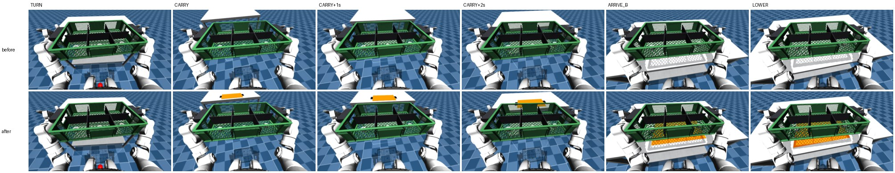
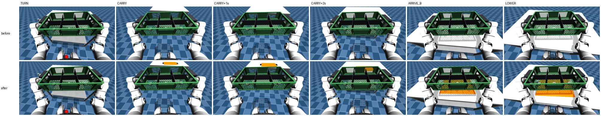
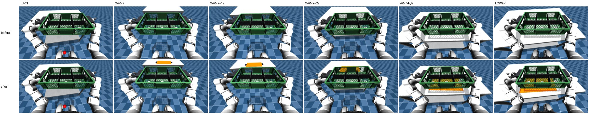

# Vùng đích hiện trong ảnh (DA-33 nhiệm vụ 13)

Ngày 11/11/2026. Hiếu duyệt qua phiên điều phối: vẽ vùng đích lên bàn B, sinh lại toàn bộ demo trên cảnh có vùng đích, rồi train hai run ghép cặp 60k bước trên cut ALL.

## 1. Vì sao

- Design 28/10/2026 mục 3.1 ghi vùng đích là "hình chữ nhật hiển thị trên bàn B". Trước 11/11/2026 (mọi demo và eval đến nay), cảnh không có geom nào cho vùng đích.
- Planner dùng tư thế đích ẩn (`sample_episode(...).target_pose`) để căn ngang khi đến bàn B và khi hạ khay. Bộ chấm cũng dùng tư thế đó (dung sai 5 cm, 10°).
- Policy chỉ nhìn ảnh nên không có tín hiệu nào cho vị trí dừng dọc bàn B dài 1,2 m. Phiên điều phối đo trên eval C: độ lệch chuẩn của lệch ngang base − đích là 13 cm ở lượt hỏng so với 5,3 cm ở lượt thành công; tay trong demo bù lệch base (r = 0,97 với đích ẩn).

## 2. Vẽ gì

| Mục | Giá trị |
|---|---|
| Hình | Body tĩnh `target_zone` trên bàn B, tại (x, y, yaw) của `target_pose`; mặt dưới nằm trên mặt bàn (z = `table_height`) |
| Hình chữ nhật | Đúng footprint khay 0,30 × 0,45 m, dày 1 mm, màu cam `(1.0, 0.42, 0.0)`: tương phản với mặt bàn thép xám và thùng xanh lá của SimReady |
| Vạch tay cầm | Hai vạch tối 0,12 × 0,04 m ngay ngoài hai cạnh ngắn, đúng chỗ hai tay cầm sẽ nằm; cho thấy góc yaw (khay đối xứng khi quay nửa vòng nên không cần mũi tên) |
| Không viền | `randomize.py` chỉ giữ footprint khay nằm trọn trên bàn; viền thêm sẽ thò ra ngoài mép bàn ở mức 1–2. Khay đặt đúng đích che kín hình chữ nhật |
| Vật lý | `contype = conaffinity = 0`, `density = 0`, không khớp; body thêm sau cùng nên mọi body khác giữ chỉ số |
| Nhóm vẽ | `VISUAL_GROUP` (2), như mesh SimReady; camera đầu và video đều vẽ |
| Đường dựng cảnh | Một chỗ: `G1WholebodyTrayTransferTeleop.reset` → `write_scene_mjcf(..., target_pose=sample.target_pose)`. Sinh demo, QA phát lại và eval của SIMPLE cùng đi qua đây |

## 3. Revision hình ảnh

- `visuals_revision` nay là `<revision SimReady>+zone1` (cảnh hộp trơn: `none+zone1`). Episode cũ ghi revision SimReady trần (`4763fbf…`), nên hai loại không bao giờ trùng.
- `generate()` và `scripts/g0/tray/generate.py` từ chối `--out` có dòng sổ của revision khác, trước khi nạp sim. `export_psi0` (nên cả `release.py`) từ chối lô có episode ghi thuộc hai revision.
- Guard của eval nằm ngoài repo: `~/denso-da34-t6/simple-guard.sh` trên `rtx3060` so `visuals_revision(default_manifest_path())` với `4763fbf…`. Với cây có vùng đích, guard đó sẽ chặn (mã 97). Eval mới cần guard so với `4763fbfaa4f8e97658e68b57d01b4c86659e08b5+zone1`; việc này thuộc người chạy eval (DA-34), không sửa ở đây.

## 4. Kiểm

### 4.1 Vật lý không đổi

| Kiểm | Kết quả |
|---|---|
| Test CPU (workspace) | `pytest packages/flywheel-simple/tests/tray`: 1318 qua, 1 bỏ qua (thiếu `av`) |
| Test sim, MuJoCo thuần ([`test_target_zone.py`](../../../packages/flywheel-simple/tests/tray/test_target_zone.py)) | Vùng đích nằm đúng (x, y, yaw) của `target_pose` ở 5 cặp (mức, seed), trên mặt bàn B, trong bàn; ba geom `contype = conaffinity = 0`, body khối lượng 0, không khớp; `nq`, `nv`, tổng khối lượng như cũ; mọi body khác giữ chỉ số. Thả khay cạnh và **lên trên** vùng đích: qpos, qvel giống từng bit qua 400 bước |
| Test sim qua SIMPLE trên `rtx3060` | 13/13 qua (163 s), gồm một episode planner đầy đủ (mức 1, seed 1279) có và không có vùng đích: qpos, qvel, ctrl giống từng số ở mọi bước. Tư thế vùng đích trong env lệch `target_pose` 1,9 µm vì MJCF dạng chữ giữ 6 chữ số có nghĩa (khay cũng vậy từ trước) |
| [`target_zone_views.py`](../../../scripts/g0/tray/target_zone_views.py), 3 episode (mức 0 seed 0, mức 1 seed 1279, mức 2 seed 125195) | Cả 3: cùng thành công, cùng chuỗi pha và thời điểm, cùng số bước (1600, 1370, 1499), chênh lớn nhất của qpos/qvel/ctrl là **0,0** |
| Sinh lại (mục 5) | So từng seed với sổ lô cũ: cùng shard, cùng kết quả, cùng số bước |

### 4.2 Thấy trong camera đầu

Camera `head_stereo_left` ra 640×360 (video của release cũng vậy). Ảnh dưới thu về 320×180 mỗi khung. Hàng trên là cảnh cũ, hàng dưới là cảnh có vùng đích; cột là đầu pha TURN, đầu CARRY, CARRY + 1 s, CARRY + 2 s, đầu ARRIVE_B, đầu LOWER.

Đọc ảnh:
- Từ đầu CARRY (vừa rẽ xong sang bàn B), vùng đích cam hiện rõ ở mép trên ảnh, phía sau khay đang bưng, cả hai vạch tối.
- Từ khoảng CARRY + 2 s, khay đang bưng che phần lớn vùng đích; chỉ còn thấy qua lưới thành thùng.
- Ở ARRIVE_B và LOWER vùng đích thấy qua đáy lưới của thùng, và phần cam thò ra ngoài mép khay cho thấy khay đang lệch về phía nào.
- Giới hạn: khay che vùng đích trong một đoạn khi đi. Đây là hình học của camera đầu với khay bưng trước ngực, không đổi được nếu không đổi task.

## 5. Sinh lại

_Điền ở nhiệm vụ con 13.3 và 13.4._
