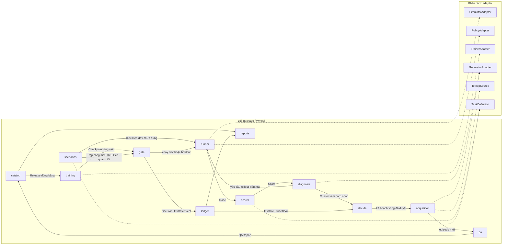
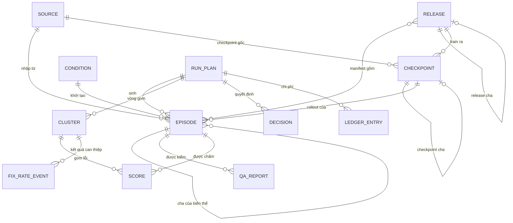
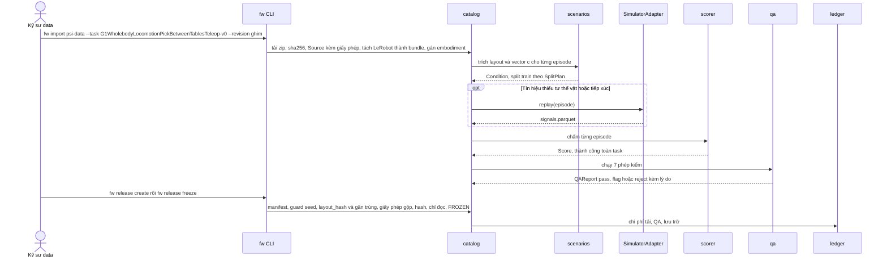
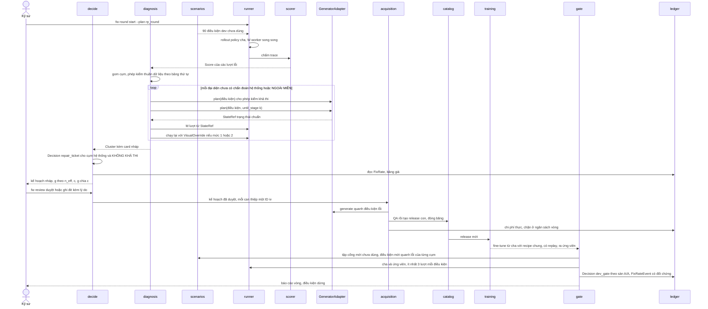
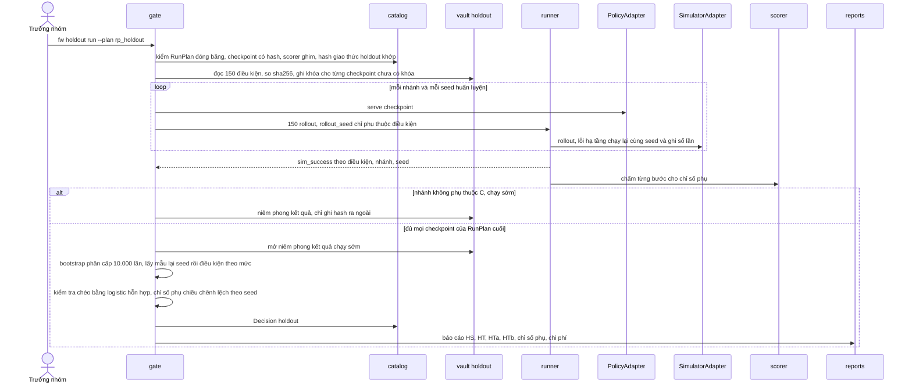
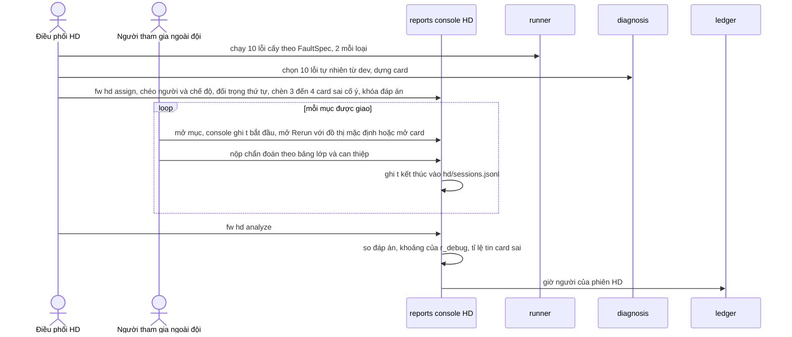

# 03 · Kiến trúc: Humanoid Data Flywheel

_Vai trò: Architect (Winston), quy trình BMAD. Ngày 22/10/2026. Đầu vào: [spec v10.1](../spec-v10-failure-to-data.md) (bản hiện hành v10.4), phản biện [05](05-review-and-mentor-questions.md) và bảng quyết định [06](06-review-round-1-decisions.md). Tài liệu trả lời câu hỏi: xây lõi flywheel thế nào để L0 chạy được trong 12 tuần, và L1–L3 chỉ cần thêm adapter và dữ liệu, không phải viết lại. Từ bản 0.3, tên giả thuyết theo 06: **HS** (sim thay được 30% demo teleop), **HT** gồm **HTa** và **HTb** (nhắm theo lỗi), **HD** (evidence card giảm thời gian chẩn đoán)._

| Ngày | Phiên bản | Thay đổi | Tác giả |
|---|---|---|---|
| 27/10/2026 | 0.7 | Theo spec v10.4 và [design ngày 27/10/2026](../superpowers/specs/2026-10-27-g1-psi0-demo-design.md): bỏ robot DENSO, MuJoCo riêng và ROS 2 (mục 1.1, 2.1, 5.4, 7.1, 7.3); SIMPLE là simulator chính, thu và sinh dữ liệu ở `--sim-mode=mujoco` (mục 2.1, ADR-25); adapter `SimpleSim` có `replay()`, thiết bị bàn phím, hai tuyến sinh tự động S1 và biến thể S2, task hai bàn, nguồn egocentric EgoDex và video tự quay (mục 1.1, 5.4); Agent QA/QC đọc báo cáo dataset và chấm trên bộ lỗi cấy (mục 2.3, ADR-26); cây mã không ghi tên người, chủ ở 07 (mục 7.1); luật import và artifact giữa làn chép vào mục 7.3 vì design chia làn đã xóa; ADR-18, ADR-21, ADR-23 bị thay | PO (Hiếu) |
| 22/10/2026 | 0.1 | Bản đầu; đã đối chiếu repo SIMPLE, Ψ₀ và psi-data (mục 3.2) | Architect |
| 22/10/2026 | 0.2 | Mục 1.1: B⁺ ghi là tùy chọn, khớp spec 7.2 và PRD 7.9 | PO |
| 22/10/2026 | 0.2 | Mục 4.3: Episode thêm `data_class` (mức phân loại theo PRD NFR6) | PO |
| 22/10/2026 | 0.2 | Mục 5.1 và 6.2: `decide` tạo RepairTicket (khớp mục 2.3 và PRD FR25); `catalog` ghi RunPlan (khớp PRD FR5) | PO |
| 22/10/2026 | 0.2 | Mục 5.2: thêm cờ `fault_injection` và `plan` để PRD FR14, FR21 có chỗ khai; mục 7.1: thêm lệnh `fw` còn thiếu | PO |
| 22/10/2026 | 0.2 | Mục 3.3, dòng V3: nêu ảnh hưởng tới correction do máy sinh, kiểm khả thi và task dự phòng F1; trỏ tới cây phương án ở 04 mục 1.3 | PO |
| 22/10/2026 | 0.2 | Mục 8.1: RunPlan mẫu không ghim sẵn `simple-checkpoints`; checkpoint gốc chốt ở G0 theo Q0 (PRD 1.3, 05 TN12) | PO |
| 22/10/2026 | 0.3 | Đổi tên giả thuyết H1, H2, H3 thành HS, HT (HTa, HTb), HD trong toàn file; lệnh `fw h3` thành `fw hd`. Không đổi mã đề và tên robot | Architect theo 06 |
| 22/10/2026 | 0.3 | 06 #1: mục 3.2, 3.3 ghi System-0 của task chính là decoupled WBC `g1_sonic`, AMO thuộc pipeline MP, V3 hạn ngày 5 Sprint 1, F1 không còn dự phòng cho Q2; mục 5.2 thêm `control_spec` theo WBC; mục 5.4 generator theo tuyến; mục 12.2 thêm tuyến T1–T4 và kịch bản V3 âm cộng Q6 âm; ADR-15 | Architect theo 06 |
| 22/10/2026 | 0.3 | 06 #2: mục 6.3 bootstrap phân cấp (seed rồi điều kiện), logistic hỗn hợp kiểm tra chéo, quy tắc 2/3 seed thành chỉ số phụ, power analysis ở G2; mục 11 test thống kê phân cấp; cổng G0 30 lượt mỗi mức | Architect theo 06 |
| 22/10/2026 | 0.3 | 06 #3: mục 2.3, 6.2 cổng dev trên tập điều kiện mới, ≥ 3 lượt, sàn A/A; đo tỉ lệ sửa được có đối chứng cha; `decide` dùng n_eff; mục 11 test tính chất "vòng 1 xếp theo đơn giá" và contract test xuất LeRobot đọc lại bằng loader Ψ₀ (AR2); mục 9.2 ước tính lại khối lượng rollout; ADR-16 | Architect theo 06 |
| 22/10/2026 | 0.3 | 06 #4: chẩn đoán NGOÀI MIỀN (mục 6.2); tăng cường thị giác là recipe chung trong RunPlan, bỏ `visual_aug` khỏi loại can thiệp (ADR-17); RunPlan và `gate` hỗ trợ B-fail, F-ACT, N_B | Architect theo 06 |
| 22/10/2026 | 0.3 | 06 #5: `diagnosis` thêm phép kiểm đồng bộ cảm biến (τ_sync) và camera chuẩn, chẩn đoán LỖI ĐỒNG BỘ và LỖI CALIBRATION; trace lưu timestamp ảnh, timestamp state và tham số camera (V11); mục 6.4 HD theo 06 mục 5 | Architect theo 06 |
| 22/10/2026 | 0.3 | 06 #8: mục 8.1 RunPlan dùng `pre.*` hoặc `postpre.*` có provenance trong Source, chỉ RunPlan `g0_repro` được trỏ `simple-checkpoints`, `sonic-checkpoints`; mục 8.3 guard gần trùng theo khoảng cách điều kiện, dải seed rời dải tác giả | Architect theo 06 |
| 25/10/2026 | 0.6 | Theo design chia làn ngày 25/10/2026 (file đã xóa ngày 27/10/2026): mục 7.1 thay bằng cây mới (nhân, ba làn, adapter, `denso-sim`, `ros2_ws`), namespace `flywheel.*`, mục 7.3 khuôn package và luật import mới; mục 5.4 thêm `denso-sim` và ROS 2; ADR-22 đến ADR-24 | PO (Hiếu) |
| 25/10/2026 | 0.5 | Theo spec v10.3 và design ngày 25/10/2026 (file đã xóa ngày 27/10/2026): robot DENSO trên MuJoCo là simulator chính, SIMPLE chỉ còn G0 (mục 2.1, 5.4, 7.1, ADR-18); Agent QA/QC trước bước kỹ sư duyệt (mục 2.3, ADR-19); `RolloutRequest.timing` cho eval bất đồng bộ (mục 5.2, ADR-20); chỉ số chính là vị từ thành công của env MuJoCo (ADR-21); package `flywheel-mujoco`, `flywheel-agentqa` (mục 7.1); rủi ro mới (mục 12.2) | PO (Hiếu) |
| 23/10/2026 | 0.4 | Theo spec v10.2 và design ngày 23/10/2026 (file đã xóa ngày 27/10/2026): mục 1.1 thêm robot DENSO, pipeline ba nguồn, probe theo stage; mục 2.1 thêm NIM trên máy 5090 và A100; mục 4.3 thêm trường episode cho nguồn dữ liệu, độ tin action, che danh tính, `segments.parquet`, `action_layout`; mục 5.4 thêm adapter robot DENSO, robot thay thế, NIM, ingest; mục 6.2 thêm bước 4b quy lỗi về stage; mục 7.1 thêm package `flywheel-ingest`, `flywheel-nim`, `flywheel-isaac` | Architect |
| 22/10/2026 | 0.3 | 06 #9: mục 2.4 L0-lite và ADR-13; mục 4 còn 12 thực thể kèm bảng gộp, `task_id`, `embodiment_id`, `site_id` là cột thường có mặc định; mục 3.1, 7, 8.4 hoãn MLflow, Streamlit, fsspec S3, phân vùng ngày, lệnh dựng lại chỉ mục, revision card; mục 10.4 backup và diễn tập khôi phục (AR3); ADR-14 chỉ số chính holdout từ cờ SIMPLE (AR4); `failure_class` (AR5); mục 9.4 phác L2 (AR6); khóa holdout theo checkpoint để chạy sớm và niêm phong | Architect theo 06 |

## 1. Giới thiệu, phạm vi, nguyên tắc

### 1.1 Phạm vi

- **Trong phạm vi L0:** mô hình dữ liệu L0-lite (mục 2.4); nạp psi-data, QA, lineage, chia tập (spec mục 4); scorer từng bước (mục 5); thuật toán Failure → Data 12 bước (mục 6); chạy E1, các nhánh A, A₀.₇, B, C, B-fail (chạy trên ACT là chính), B⁺ (tùy chọn, ưu tiên thấp hơn B-fail), chuỗi vòng F-ACT trên ACT và holdout ghép cặp (mục 7.1–7.5); thí nghiệm HD (mục 7.6); sổ chi phí (mục 8).
- **Thêm từ bản 0.4, sửa ở bản 0.7:** task hai bàn của G1 trong SIMPLE; ba loại dữ liệu (egocentric, teleop, synthetic), nguồn test bây giờ là mẫu EgoDex, dataset teleop của tác giả, teleop bàn phím, synthetic S1 và S2; pipeline 6 tầng về một định dạng episode chung, có phát lại action; probe P1–P4 trên checkpoint từng stage Ψ₀; log train theo nhóm action; bảng lỗi 5 nguồn tín hiệu; Agent QA/QC; thí nghiệm HE (spec mục 7.9). Chi tiết ở [design ngày 27/10/2026](../superpowers/specs/2026-10-27-g1-psi0-demo-design.md). Synthetic tầng S3–S4 qua NIM để sau PoC.
- **Ngoài phạm vi L0:** robot thật, nhiều người dùng, giao diện web đầy đủ, dịch vụ mạng của riêng ta. Tài liệu chỉ để sẵn điểm nối cho các phần này (mục 9).

### 1.2 Nguyên tắc kiến trúc

| Nguyên tắc | Hệ quả kỹ thuật bắt buộc |
|---|---|
| Lõi không phụ thuộc model, simulator, robot | Package lõi `flywheel` không import `simple`, `psi0`, `lerobot`, `torch`. Mọi thứ cụ thể đi qua 6 Protocol ở mục 5.2. Một test import-linter chặn vi phạm |
| File-based và tái lập trước, dịch vụ sau | Nguồn sự thật là file bất biến (JSONL, Parquet, MP4) cộng một tệp DuckDB chỉ chứa view. Không có DB server hay API service ở L0 |
| Mọi thứ có ID, phiên bản, hash | Thực thể định nghĩa bởi nội dung (release, điều kiện, RunPlan, checkpoint) lấy ID từ hash; thực thể sự kiện (episode, mục sổ) dùng ULID. Mọi bản ghi mang `schema_version` |
| Chi phí là dữ liệu hạng nhất | Không có job nào chạy mà không sinh `LedgerEntry`. Ước tính và thực đo là hai trường khác nhau, không ghi đè nhau |
| Hệ thống trước, dữ liệu sau | Lỗi hạ tầng (simulator sập, server timeout) không bao giờ được tính là lỗi policy; chẩn đoán hệ thống chặn nhánh dữ liệu (spec 6.9) |
| Không xóa, chỉ đánh dấu | Mẫu bị loại, ứng viên trượt cổng, vòng không cải thiện đều giữ cùng lý do và chi phí (spec 4.4, 7.7) |
| Kỹ sư quyết, máy đề xuất | Mọi điểm quyết định (duyệt kế hoạch, ghi đè chẩn đoán, ký cổng) là một bản ghi `Decision` có người, thời điểm, lý do |
| Holdout là tài sản niêm phong | Holdout nằm trong vault riêng, chỉ `gate` đọc, mỗi checkpoint đúng một lần (mục 8.3) |

## 2. Kiến trúc tổng thể

### 2.1 Hình thái hệ thống

Lõi là **một thư viện Python kèm CLI `fw`**, chạy trên máy host. Adapter nặng (SIMPLE, Ψ₀, LeRobot) chạy **ngoài tiến trình**, trong container riêng của chúng. Lõi và container trao đổi qua **job spec JSON và thư mục dùng chung** (mount), còn simulator và policy nói chuyện với nhau qua server policy sẵn có của SIMPLE (HTTP hoặc WebSocket). Lý do: SIMPLE dùng Python 3.10 và ghim `lerobot==0.3.3`, Ψ₀ dùng Python 3.11, torch 2.7, flash-attn; ghép chung một môi trường là nguồn lỗi lớn nhất trong 12 tuần. Bố trí máy ở L0:

| Máy | Chạy gì |
|---|---|
| RTX 5090 32 GB (máy chính) | Catalog và view DuckDB, container SIMPLE (W worker song song), server suy luận Ψ₀; từ bản 0.4: NIM Cosmos Reason bản nano tự host (khoảng 23 GB, chạy xen kẽ với server Ψ₀, không cùng lúc) |
| RTX 3060 12 GB | Train ACT và Diffusion Policy (gồm B-fail và F-ACT), test CPU, dựng báo cáo, console HD; nhận backup hằng ngày của máy chính |
| A100 80 GB thuê theo giờ | Fine-tune Ψ₀ (stage 2 và 3); từ bản 0.4: NIM Cosmos Transfer và Predict tự host cho tầng S3–S4; chỉ nhận job spec và bản export dataset, trả checkpoint, video sinh và log về qua rsync |

Máy 5090 là điểm hỏng đơn lẻ (05 AR3). Bù bằng backup hằng ngày sang máy 3060 và một lần diễn tập khôi phục trước G3 (mục 10.4).

**Bản 0.5, sửa ở bản 0.7.** Máy đội đang có: RTX 3060 12 GB (dev, SIMPLE ở `--sim-mode=mujoco`, teleop bàn phím, phát lại action, ACT và DP, Agent QA/QC với Nemotron bản Q4, thử inference Ψ₀) và Colab Pro chạy qua CLI (A100, H100) cho fine-tune Ψ₀. Máy 5090 ở bảng trên chờ xác nhận còn dùng được. Mọi dữ liệu của demo là `public` (psi-data, sim G1) nên Colab nhận được mọi job; quy tắc `data_class` vẫn giữ trong mã. Job trên Colab phải tiếp tục được từ checkpoint và ghi compute unit vào sổ chi phí. Eval có render Isaac (`mujoco_isaac`) mất 6–10 phút mỗi episode theo README Ψ₀; S1-04 đo cả hai chế độ.

### 2.2 Sơ đồ module



Mũi tên liền là luồng dữ liệu giữa module lõi; mũi tên chấm là lời gọi qua Protocol. Mọi module đều ghi `LedgerEntry` qua `ledger.meter(...)`; sơ đồ bỏ các mũi tên đó cho gọn.

### 2.3 Luồng dữ liệu của một vòng flywheel

1. `scenarios` cấp 90 điều kiện dev chưa dùng (lấy từ dải dev của SplitPlan) cho bước tìm lỗi.
2. `runner` mở `PolicyEndpoint` qua `PolicyAdapter.serve`, phát `RolloutRequest` tới `SimulatorAdapter.rollout` với W worker song song. Mỗi rollout trả một trace bundle có timestamp ảnh, timestamp state và tham số camera; `catalog` ghi Episode (kind `eval_rollout`, split `dev`). Bước 1 của spec.
3. `scorer` chạy vị từ của `TaskDefinition` trên tín hiệu đo được, ra `Score` (trạng thái từng bước, bước hỏng đầu tiên k, kiểu lỗi, `failure_class`, mức), đồng thời đối chiếu với cờ thành công của SIMPLE. Bước 2.
4. `diagnosis` gom cụm theo (k, kiểu lỗi, mức), chạy các phép kiểm thuần dữ liệu cho mọi lỗi và các phép kiểm tốn rollout trên tối đa R đại diện, theo đúng thứ tự ở bảng mục 6.2 (thêm đồng bộ cảm biến, camera chuẩn, NGOÀI MIỀN theo 06). Phép khả thi gọi `GeneratorAdapter.plan`; phép khoanh vùng lấy trạng thái chuẩn từ `plan(until_stage=k)` rồi nhờ `runner` chạy M lượt; phép thị giác nhờ `runner` chạy lại với `VisualOverride`. Kết quả nằm trong Cluster kèm card nháp. Bước 3–9. Nhánh B-fail tắt bước này.
5. `decide` đọc Cluster, phân phối tỉ lệ sửa được và bảng giá từ `ledger`, lập đề xuất có g theo n_eff và c, chọn tham lam theo g/c trong ngân sách vòng. Kỹ sư duyệt hoặc ghi đè bằng `fw review`, ghi thành `Decision` (`plan_review`). Cụm hệ thống thành `Decision` (`repair_ticket`). Bước 10–11.
6. `acquisition` thực thi kế hoạch qua `GeneratorAdapter.generate` và `TeleopSource`, đo ngân sách theo thời gian thực, đưa mọi episode qua `qa`; `catalog` tạo release con và đóng băng. Bước 12a.
7. `training` dựng `TrainSpec` từ recipe chung của RunPlan (gồm tăng cường thị giác cố định, ADR-17), gọi `TrainerAdapter`, đăng ký `Checkpoint` ứng viên. Bước 12b.
8. `gate` xin `scenarios` một tập cổng mới chưa dùng, chạy cha và ứng viên ≥ 3 lượt mỗi điều kiện, so với sàn A/A, ra `Decision` (`dev_gate`); nếu đạt thì cập nhật con trỏ `refs/policy/<nhánh>/current`. Bước 12c.
9. `gate` đo tỉ lệ sửa được có đối chứng trên điều kiện mới quanh điểm lỗi của từng cụm đã can thiệp (mục 6.2); `ledger` lưu `FixRateEvent`; `reports` dựng card, báo cáo vòng, sổ chi phí.

**Bản 0.5.** Ở bước 2, closed-loop eval chạy ở chế độ bất đồng bộ cho chỉ số chính (ADR-20). Giữa bước 4 và bước 5, **Agent QA/QC** đọc báo cáo dataset (bản 0.7), log train, eval, inference và output từng stage do code dựng (bảng ảnh của stage 1, video MuJoCo phát lại action dự đoán của stage 3, dòng thời gian RTC), viết báo cáo HTML tĩnh có insight và ước lượng; kỹ sư đọc báo cáo này cùng evidence card khi chạy `fw review` (ADR-19). Ở bước 6, mọi episode có action robot qua phát lại trên MuJoCo trước `qa`.

### 2.4 L0-lite: phạm vi xây ở L0

05 AR1 chỉ ra bản 0.2 quá sức cho đội Data-Platform 2 người: 28 loại thực thể, MLflow, Streamlit, fsspec sẵn S3, bảng phân vùng theo ngày, lệnh dựng lại chỉ mục, revision của card, đối tượng `HoldoutAccess`. 06 mục 9 chốt **L0-lite** (ADR-13). Nguyên tắc chọn: giữ mọi thứ bảo vệ kết luận (hash, guard, khóa holdout, sổ chi phí) và mọi trường mở rộng gần như không tốn công; hoãn mọi thứ chỉ để tiện.

| Hạng mục | Ở L0-lite | Hoãn tới | Lý do |
|---|---|---|---|
| Thực thể | 12 bảng catalog (mục 4.3); trường mở rộng nằm trong `meta` | Tách lại thực thể riêng khi L1 cần truy vấn thường xuyên | Ít model, ít test ở Sprint 1–2 |
| Cột mở rộng | `task_id`, `embodiment_id`, `site_id` là cột thường có mặc định; thêm `schema_version`, `meta` | Không hoãn | Gần như không tốn công; giữ đường L1–L4 |
| Hash release, RunPlan đóng băng | Giữ | Không hoãn | Điều kiện tái lập |
| Guard chia tập | Giữ: seed, `layout_hash`, gần trùng theo khoảng cách (mục 8.3) | Không hoãn | Chống rò |
| Khóa holdout | Tệp điều kiện có sha256, khóa theo checkpoint, test CI chặn module khác đọc vault | Đối tượng `HoldoutAccess` ở L1 khi nhiều người dùng | Đủ cho 5 người và kiểm được tự động |
| Ledger | JSONL append-only trong thư mục job | Không hoãn | Nguồn sự thật của chi phí |
| Trace | Parquet theo episode | Không hoãn | Đọc theo cột cho scorer |
| Chỉ mục | Một tệp DuckDB chỉ chứa view trên JSONL và Parquet, tự tạo khi mở | Lệnh `fw index rebuild` ở L1 | View không giữ dữ liệu riêng nên không có gì để dựng lại |
| Bảng metadata | `catalog/<bảng>/part-<ulid>.jsonl`, không phân vùng ngày | Phân vùng ngày ở L1 khi bảng lên hàng triệu dòng | L0 chỉ vài chục nghìn dòng |
| Lưu trữ đối tượng | Đĩa cục bộ qua `pathlib`, địa chỉ hóa sha256 | fsspec, MinIO hoặc S3 ở L1 | Một máy chính |
| Theo dõi thí nghiệm | `metrics.jsonl` trong thư mục job, đồ thị tĩnh trong `reports` | MLflow ở L1 nếu cần so nhiều run | Trùng vai trò với ledger và catalog |
| Console HD | Lệnh Typer, card HTML tĩnh, Rerun cho chế độ đối chứng | Streamlit hoặc web ở L1+ | 02 §8 đã cho phép cắt |
| Evidence card | Sinh lại từ Cluster và Decision, không có revision | Revision card ở L1 | Quyết định và lý do ghi đè đã nằm trong Decision |
| Backup | Hằng ngày sang máy 3060, diễn tập trước G3 (mục 10.4) | Bản ngoài site ở L1 | 05 AR3 |

Giữ nguyên 12 module và 6 package. Tên module là ranh giới trách nhiệm, chi phí chỉ là một thư mục; mỗi module ở L0 chỉ hiện thực phần story cần, theo thứ tự ở 04. Package adapter phải tách vì môi trường Python khác nhau (ADR-02).

## 3. Tech stack

### 3.1 Lựa chọn

| Hạng mục | Chọn | Lý do | Phương án thay thế (khi nào đổi) |
|---|---|---|---|
| Ngôn ngữ, quản lý gói | Python ≥ 3.10, uv workspace | Cả SIMPLE và Ψ₀ đều dùng uv; lõi chạy được trên 3.10 để dùng chung contract với worker trong container SIMPLE | Poetry (không lợi gì thêm) |
| Schema bản ghi | Pydantic v2; xuất JSON Schema cho worker | Một nguồn schema cho validate, serialize, tài liệu; worker trong container chỉ cần JSON Schema nên không xung đột phiên bản Pydantic | dataclasses + msgspec nếu cần tốc độ |
| Dữ liệu dạng bảng | Parquet (pyarrow) cho trace và manifest release; JSONL cho bản ghi catalog và ledger | Trace cần đọc theo cột; bản ghi metadata nhỏ, có `meta` tự do, ghi nối từng dòng không cần schema cột cố định; DuckDB đọc trực tiếp cả hai | HDF5 (khó append, khó truy vấn) |
| Định dạng trao đổi dữ liệu train | LeRobotDataset, đúng phiên bản SIMPLE và Ψ₀ đang dùng | SIMPLE và Ψ₀ đều đọc và ghi LeRobot; README Ψ₀ yêu cầu khớp phiên bản `lerobot` và `datasets` với SIMPLE | Không có; đây là ràng buộc của recipe |
| Lưu trữ episode nội bộ | Bundle theo episode: `frames.parquet`, `signals.parquet`, `videos/*.mp4`, `meta.json` | Episode bất biến dùng chung cho nhiều release; LeRobot đánh chỉ số theo vị trí trong một dataset nên thêm hoặc bớt episode phải viết lại (ADR-03). Bộ export có contract test đọc lại bằng loader Ψ₀ (mục 11) | Lưu thẳng LeRobot và coi release là danh sách chỉ số, nếu G0 cho thấy loader Ψ₀ lọc được theo chỉ số |
| Chỉ mục metadata | DuckDB nhúng, một tệp chỉ chứa view trên `catalog/**` và `runs/**`, tự tạo khi mở | Truy vấn phân tích (tỉ lệ theo mức, cụm, bootstrap) nhanh; không cần server; mất tệp không mất gì | SQLite (tốt hơn cho ghi giao dịch nhỏ, kém cho phân tích); Postgres ở L4 |
| Lưu trữ đối tượng | Đĩa cục bộ qua `pathlib`, địa chỉ hóa theo sha256, bọc trong module `store` | Một máy chính ở L0; mọi đường dẫn đi qua `store` nên L1 thêm fsspec mà không đổi module khác | fsspec cộng MinIO hoặc S3 ở L1; DVC hoặc lakeFS (thêm công học, chưa cần) |
| Cấu hình | YAML, validate bằng Pydantic, hash khi ghim vào RunPlan | Đọc được, diff được trong git; không cần cơ chế compose của Hydra | Hydra (khi có hàng chục biến thể cấu hình) |
| CLI, log, video | Typer; structlog (JSON lines); giữ nguyên MP4 SIMPLE xuất ra, đọc bằng PyAV | SIMPLE cũng dùng Typer; log gắn sẵn `run_plan_id`, `job_id`, `episode_id`; không mã hóa lại video để tránh lệch khung | Click; logging chuẩn |
| Theo dõi thí nghiệm | `metrics.jsonl` trong thư mục job; `reports` vẽ đường cong train thành HTML tĩnh | MLflow trùng vai trò với ledger và catalog (05 AR1); bớt một dịch vụ trên máy 5090; máy A100 chỉ cần ghi tệp | MLflow tự host ở L1 nếu cần so nhiều run; W&B offline nếu script Ψ₀ gắn sẵn W&B |
| Container | Docker và docker compose; image `ghcr.io/physical-superintelligence-lab/simple` và `.../psi0`, ghim theo digest | Repo phát hành sẵn image; ghim digest thay cho tag `latest` để tái lập | Nix (repo SIMPLE hỗ trợ) nếu Docker gặp vấn đề GPU |
| Song song rollout | `concurrent.futures` trên W container SIMPLE | Đủ cho một máy ở L0; không cần cụm | Ray ở L1 khi chạy nhiều máy |
| Tính toán thống kê | numpy, scipy; statsmodels (`BinomialBayesMixedGLM`) cho logistic hỗn hợp | Bootstrap phân cấp seed rồi điều kiện, kNN brute force (vài nghìn điểm); mô hình hỗn hợp chỉ để kiểm tra chéo nên chấp nhận suy luận xấp xỉ | lme4 qua R nếu hai cách lệch nhau đáng kể; FAISS khi điều kiện lên hàng triệu (L3+) |
| Báo cáo, card | Jinja2 ra HTML và Markdown tĩnh; console HD là lệnh Typer; chế độ đối chứng của HD mở trace bằng Rerun (`rerun-sdk`, extra `hd`) với đồ thị mặc định | Card cần mở offline và lưu cùng run; HD cần bấm giờ, nhập đáp án và một công cụ chuẩn làm đối thủ (06 mục 5) | Streamlit hoặc web app ở L1+ |
| Backup | `rsync` qua SSH hằng ngày sang máy 3060, giữ 7 bản theo ngày bằng `--link-dest` | Không thêm dịch vụ; khôi phục bằng copy | restic hoặc kho ngoài site ở L1 |
| Kiểm thử, chất lượng | pytest, hypothesis, ruff, mypy, import-linter; GitHub Actions cho test CPU | Protocol cần kiểm kiểu tĩnh; test GPU chạy tay trên máy 5090 | — |

### 3.2 Đã kiểm chứng từ nguồn (ngày 22/10/2026)

| Điểm | Kết quả | Nguồn |
|---|---|---|
| Nền simulator | Isaac Sim 4.5 và MuJoCo 3.3; cần GPU RTX trên Ubuntu 22.04; cài bằng uv, Nix hoặc Docker; giấy phép MIT | [README SIMPLE](https://github.com/physical-superintelligence-lab/SIMPLE) |
| Hai simulator trong một env | `BaseDualSim` là `gymnasium.Env`: MuJoCo lo vật lý ở 500 Hz, Isaac Sim chỉ render (50 Hz cho whole-body); `Simulator` có `get_states()` và `set_states()` | [Core architecture](https://psi-lab.ai/SIMPLE/docs/core/architecture.html) |
| Đánh giá client–server | Server policy (`Psi0Server`, `Pi05Server`, `GR00TServer`) là tiến trình riêng, có `health()` và `act()`, gọi qua HTTP hoặc WebSocket. Ψ₀ mặc định cổng 22085, kiểm sức khỏe bằng `GET /health`. Client SIMPLE chạy `eval-decoupled-wbc` với `--data-format lerobot`, `--data-dir data/evals/simple-eval/<task>/<level>`, `--host`, `--port`, `--headless` | [README Ψ₀](https://github.com/physical-superintelligence-lab/Psi0), [Decoupled WBC evaluation](https://psi-lab.ai/SIMPLE/docs/decoupled-wbc/evaluation.html) |
| Đầu ra đánh giá | `eval_stats.txt` và video theo episode `episode_<i>/<camera>_{success hoặc failed}.mp4` | Như trên |
| Điều kiện ban đầu | `Task.reset(seed, options)` dựng một `Layout`; `state_dict()` và `load_state_dict()` tuần tự hóa layout để tái hiện đúng khi replay hoặc đánh giá; `check_success()` và `decompose()` (ra `SubtaskSpec`) có sẵn | [Task](https://psi-lab.ai/SIMPLE/docs/core/task.html) |
| Ngẫu nhiên hóa | `DRManager` gồm `TargetDR`, `DistractorDR`, `SpatialDR`, `MaterialDR`, `LightingDR`, `TabletopSceneDR`, `CameraDR`, `LanguageDR`. `DRManager.load_state_dict(state_dict, dr_level)` cho phép giữ layout đã ghi và chỉ ngẫu nhiên lại một phần. Tập đánh giá là thư mục LeRobot có `meta/episodes.jsonl` | [Domain randomization](https://psi-lab.ai/SIMPLE/docs/dr/index.html) |
| Bộ điều khiển của task chính | Task `*Teleop-v0` (gồm task chính `G1WholebodyLocomotionPickBetweenTablesTeleop-v0`, bản 0.7) chạy trên `SonicLocoManipEnv`, robot `g1_sonic`, stack GR00T decoupled WBC, agent `psi0_decoupled_wbc`. Task `*MP-v0` chạy trên `LocoManipulationEnv`, robot `g1_wholebody`, thân dưới AMO. **Vì vậy System-0 của task chính là decoupled WBC `g1_sonic`, không phải AMO; AMO là bộ điều khiển của pipeline MP.** Kiểm hệ thống nhắm stack WBC, "lệnh gửi" và "trạng thái đo" theo giao diện WBC (mục 5.2) | [G1 Decoupled](https://psi-lab.ai/SIMPLE/docs/tasks/g1_decoupled.html), [G1 MP (AMO)](https://psi-lab.ai/SIMPLE/docs/tasks/g1_mp_amo.html) |
| Sinh dữ liệu motion planning | `uv run datagen simple/<task>MP-v0 --sim-mode=mujoco_isaac ...`, dùng `CuRoboPlanner`; chỉ ghi episode thành công (`clear_episode_buffer()` bỏ episode hỏng); xuất LeRobot | [Motion Planning](https://psi-lab.ai/SIMPLE/docs/data_gen_mp.html) |
| Ψ₀: cài đặt, train, serve | Python 3.11, torch 2.7 cu12, `flash_attn==2.7.4.post1`; fine-tune `scripts/train/psi0/finetune-simple-psi0.sh <task>`; khuyên batch toàn cục 128; serve `serve_psi0 --port 22085 --run-dir ... --ckpt-step ... --action-exec-horizon=24 --rtc`; checkpoint trên HF `USC-PSI-Lab/psi-model`, thư mục `psi0/` có `pre.*`, `postpre.*`, `sonic-checkpoints/`, `simple-checkpoints/` (05 TH12). Hai thư mục cuối chỉ dùng tái tạo số công bố ở G0 (mục 8.3); giấy phép mã Apache 2.0 | [README Ψ₀](https://github.com/physical-superintelligence-lab/Psi0) |
| psi-data | Tổng 469 GB; chưa có dataset card, **không ghi giấy phép**. `simple/` có 18 file zip (task chính 107.703.398 byte). `simple-eval/` có 25 file zip, của task chính là 378.554 byte | [psi-data](https://huggingface.co/datasets/USC-PSI-Lab/psi-data), API cây thư mục của HF |

### 3.3 Cần kiểm ở G0

| Mã | Câu hỏi | Ảnh hưởng tới kiến trúc |
|---|---|---|
| Q0 | Checkpoint `pre.*` hoặc `postpre.*` nào đã xác nhận không train trên dữ liệu SIMPLE hoặc sonic của task chính (hỏi PSI Lab, spec 2.4) | `Source.provenance` của checkpoint gốc; `fw plan freeze` từ chối checkpoint gốc chưa sạch cho E1 và các nhánh (mục 8.3) |
| V1 | `codebase_version` LeRobot trong `meta/info.json` của gói task chính (dự đoán v2.x vì SIMPLE ghim `lerobot==0.3.3` và có `meta/episodes.jsonl`) | Bộ đọc trong `catalog` và bộ export trong `TrainerAdapter` |
| V2 | Giao thức và thông điệp của `act()`: HTTP hay WebSocket, khóa quan sát, chiều action, kích thước chunk; vì sao ví dụ client dùng cổng 21000 hoặc 9000 còn server nghe 22085 | `PolicyEndpoint`, cách `runner` đo độ trễ, tên kênh lệnh thân trên của `ControlSpec` |
| V3 | **Bộ điều khiển khác nhau. Hạn: ngày 5 của Sprint 1, story riêng.** Dữ liệu teleop của task chính đi qua decoupled WBC (`g1_sonic`), là System-0 của task chính; AMO (`g1_wholebody`) chỉ thuộc pipeline MP. Rollout MP có cùng bộ điều khiển và không gian action với demo teleop không; nếu không thì ánh xạ được không? | Hai embodiment khác nhau; `catalog` cấm trộn trong một release nếu không có ánh xạ (ADR-08). Quyết định GeneratorAdapter, `PlannerCorrectionSource` và phép kiểm khả thi. V3 âm thì chọn tuyến T1–T4 ở mục 12.2. Task F1 **không còn là dự phòng cho Q2** cho tới khi V3 xác nhận cặp Teleop và MP của F1 cùng bộ điều khiển; F1 chỉ kiểm khả năng tổng quát của lõi (NFR7) |
| V4 | `set_states()` giữa episode có khôi phục đủ trạng thái MuJoCo, trạng thái bên trong WBC, hàng đợi action và RTC của policy không (Q3) | Có hay không phép kiểm khoanh vùng (`capabilities().restore_state`) |
| V5 | Có giữ layout vật lý và chỉ đặt ánh sáng, vật liệu về mức chuẩn được không, qua `load_state_dict` cộng ghi đè `LightingDR` và `MaterialDR` (Q4). Docs mô tả mức DR theo hai cách ngược nhau; phải đối chiếu mã nguồn | Có hay không phép kiểm thị giác (`capabilities().visual_override`) |
| V6 | `reset(seed)` có tất định không; tự sinh được tập dev, tập cổng và holdout theo định dạng `simple-eval` không; episode psi-data có ghi layout hoặc seed không; tác giả dùng dải seed nào cho psi-data và `simple-eval` | `scenarios` gán split cho demo teleop thế nào; chọn dải seed dev và holdout rời dải tác giả (mục 8.3) |
| V7 | Tín hiệu từng bước lấy được: lệnh thân trên và lệnh thân dưới gửi cho WBC, giá trị đo tương ứng, tư thế vật, tiếp xúc tay–vật, va chạm, chiều cao và độ nghiêng thân | Scorer, `ControlSpec` và phép kiểm bám lệnh; nếu thiếu thì phải replay trong sim |
| V8 | VRAM, GPU-giờ fine-tune Ψ₀, thời gian mỗi episode đánh giá, số worker SIMPLE vừa 32 GB, W khi policy là ACT (Q5) | W, lịch máy, ngân sách A100, quy mô F-ACT (mục 9.2) |
| V9 | Giấy phép psi-data, trọng số psi-model, cảnh HSSD và tài sản Objaverse | Trường `license` và quy tắc lan truyền (mục 10.3) |
| V10 | Cách SIMPLE phục vụ ACT và Diffusion Policy (agent nào, server nào) | `LeRobotPolicy` |
| V11 | Trace có timestamp riêng cho state và cho từng khung ảnh của từng camera không; đọc được nội tham số và ngoại tham số camera mỗi episode không; cấy được trễ khung camera và lệch ngoại tham số không | Phép kiểm đồng bộ cảm biến và camera chuẩn (mục 6.2); nếu không, hai phép kiểm `skipped` và lỗi cấy trễ camera, lệch calibration không có lớp tương ứng |

## 4. Mô hình dữ liệu

### 4.1 Quy ước chung

- **ID:** thực thể theo nội dung dùng `<tiền tố>_<16 ký tự đầu sha256 của JSON chuẩn hóa>` (khóa sắp xếp, số dạng chuẩn, không khoảng trắng), ví dụ `rel_`, `cond_`, `rp_`, `ckpt_`. Thực thể sự kiện dùng `<tiền tố>_<ULID>`, ví dụ `ep_`, `led_`, `dec_`. Thư mục job dùng `job_<ULID>`.
- **Cột có mặt trong mọi bảng từ L0, là cột thường có giá trị mặc định:** `site_id` (mặc định `local`), `task_id` (mặc định lấy từ RunPlan), `embodiment_id` (mặc định lấy từ RunPlan), `schema_version`. Mọi bảng có thêm `meta` (JSON) cho trường mở rộng. `domain` (`sim` hoặc `real`) nằm trong cấu hình Embodiment vì embodiment quyết định miền.
- **Đơn vị và khung:** SI, radian; khung thế giới z hướng lên; quaternion thứ tự (w, x, y, z) như MuJoCo. `t_state` và `t_image` tính bằng giây từ đầu episode (float64) theo đồng hồ sim, cộng `started_at` UTC; không gộp hai timestamp thành một cột. Khung ảnh gắn `frame_index` khớp hàng trong `frames.parquet`.
- **Điều kiện** lưu thành map có kiểu theo `ConditionSchema`, không thành cột cố định, để task mới thêm trường mà không đổi bảng.
- **Cấu hình có hash, không phải thực thể catalog:** Embodiment (gồm `controller`, `domain`, `camera_ref_hash`), Task (gồm `ConditionSchema`, `StageSpec`, `FailureKindSpec`), SplitPlan, PriceBook, ngưỡng QA và chẩn đoán, recipe train. Mỗi tệp YAML nằm trong `configs/`, validate bằng Pydantic, hash được ghim trong RunPlan.

### 4.2 Quan hệ



### 4.3 Thực thể L0-lite

Mười hai bảng catalog. Cột chung ở mục 4.1 không ghi lại.

| Thực thể | Khóa | Cột chính | Phiên bản và bất biến |
|---|---|---|---|
| Source | `src_<hash>` | URL, repo, revision HF hoặc git, sha256 tệp tải về, `license`, ngày tải, `provenance` (dữ liệu đã dùng để train nếu là checkpoint, bằng chứng, `clean_for_main_task`: true, false hoặc unknown) | Bất biến; tệp gốc giữ nguyên; provenance đổi là Source mới |
| Condition | `cond_<hash>` | `condition_seed`, `level`, vector c (map theo ConditionSchema), `layout_hash`, `split`, `set_id`, `quarantined` kèm lý do; `meta`: `layout_ref` (blob `state_dict` của SIMPLE), nguồn (sinh hay trích từ demo) | Bất biến; hash gồm task, schema và layout. Holdout không nằm ở bảng này mà trong vault |
| Episode | `ep_<ULID>` | `kind` (teleop_demo, teleop_correction, recovery, sim_rollout, variant, eval_rollout, diag_rollout), `operator_kind` (human hoặc machine), `is_root`, `root_id`, `parent_id`, `condition_id`, `source_id` hoặc `intervention_id`, `run_plan_id`, URI bundle, `license`, `data_class` (public, internal, restricted), `split`. Với trace: `checkpoint_id`, `rollout_seed`, `sim_success`, `infra_status`, `camera_params_hash`; `meta`: `generator_version`, fps, số khung, `start_state_ref`, `visual_override`, `fault_spec` | Nội dung bundle bất biến sau khi ingest |
| QAReport | `qa_<ULID>` | `episode_id`, phiên bản ngưỡng, quyết định (pass, flag, quarantine, reject), lý do; `meta`: giá trị và ngưỡng của 7 phép kiểm | Append-only; trạng thái QA hiện hành là bản mới nhất |
| Release | `rel_<hash>` | tên, `parent_release_id`, hash SplitPlan, trạng thái (draft hoặc frozen); manifest `items.parquet` mỗi dòng một (`episode_id`, trọng số mẫu, cờ `excluded` kèm lý do); `meta`: số đếm theo kind và theo `is_root`, giấy phép gộp | Frozen thì bất biến; hash tính trên manifest |
| Checkpoint | `ckpt_<hash>` | `method`, `branch`, `base_source_id`, `parent_checkpoint_id`, `release_id`, seed huấn luyện, hash trọng số, URI; `meta`: số bước, `train_job_id`, revision upstream | Bất biến |
| RunPlan | `rp_<hash>` | `purpose` (g0_repro, e1, branch_train, aa_test, round, holdout, hd), `branch`, `method`, đường dẫn `runplan.lock.json`, thời điểm đóng băng | Đóng băng trước khi chạy (mục 8.1). Vòng flywheel là RunPlan `purpose = round` |
| Score | `sc_<hash trace + scorer_version>` | `episode_id`, `scorer_version`, thành công theo scorer, trạng thái 6 bước (đạt, trượt, chưa thử, chưa rõ, kèm t vào và t ra), bước hỏng k, kiểu lỗi (L-REACH…L-UNKNOWN), `failure_class`, mức; `meta`: sai số bám lệnh theo nhóm WBC, độ trễ p99, lệch đồng bộ p99, tín hiệu thiếu | Bất biến theo `scorer_version`; chấm lại là bản mới |
| Cluster | `clu_<hash>` | `run_plan_id` của vòng, khóa (k, kiểu lỗi, mức), thành viên, đại diện và seed chọn, chẩn đoán cụm, `parent_cluster_id` khi tách theo chẩn đoán; `meta`: kết quả từng phép kiểm (giá trị, ngưỡng, số lượt, ID rollout đã dùng, `skipped` kèm lý do), đề xuất có g, c | Bất biến trong vòng; card HTML là bản dựng từ Cluster và Decision |
| FixRateEvent | `fre_<ULID>` | loại can thiệp, chẩn đoán, kiểu lỗi, `failure_class`, họ task, `cluster_id`, `intervention_id`, n điều kiện đo, p của cha, p của ứng viên, fixed_j | Append-only; posterior Beta là phép gộp lúc đọc |
| LedgerEntry | `led_<ULID>` | hoạt động, loại tài nguyên, số lượng, đơn vị, `pricebook_id`, thành tiền, `estimated` hay `measured`, nhánh, `run_plan_id`, cụm, `intervention_id`, job, người (mã giả danh) | JSONL append-only; sửa sai bằng bút toán đảo |
| Decision | `dec_<ULID>` | `kind` (plan_review, dev_gate, aa_test, holdout, milestone, repair_ticket), đối tượng (ID), số đo, tiêu chí đã chốt, kết luận, người ký, lý do; `meta`: với `plan_review` là danh sách can thiệp đã duyệt (`iv_<ULID>`, loại, cụm, số lượng, chi phí ước tính) và ghi đè; với `repair_ticket` là trạng thái và `rebaseline_required` | Append-only; trạng thái hiện hành là bản mới nhất cùng đối tượng |

**Trường thêm ở bản 0.4, sửa ở bản 0.7** (design mục 6.1; bản 0.7 thêm `source_detail`, `renderer`, `injected_defect` và `embodiment_id` riêng cho dữ liệu AMO). Episode thêm cột `source_kind` (teleop, egocentric, synthetic), `action_quality` (measured, planned, retargeted, pseudo, none) và `deid_status` (raw, blurred, verified); `meta` thêm `synthetic_tier` (S1–S4). Bundle episode thêm `segments.parquet` (đoạn theo bước task, nhãn ngôn ngữ, nguồn nhãn). `frames.parquet` đặt cột theo nhóm action của Embodiment với hậu tố `_cmd` và `_meas`. Cấu hình Embodiment thêm `action_layout`: vị trí từng nhóm trong vector action 36 chiều của Ψ₀ và mask phần đệm. Episode `pseudo` hoặc `retargeted` chỉ vào train khi RunPlan cho phép; `catalog` chặn rời bước Annotate nếu `deid_status = raw`.

**Gộp 28 thực thể của bản 0.2 vào L0-lite.** Tên cũ vẫn dùng được trong 02, 04 và story như tên khái niệm; bảng dưới chỉ ra nơi lưu.

| Thực thể ở bản 0.2 | Ở L0-lite |
|---|---|
| Embodiment, Task, ConditionSchema, PriceBook | Cấu hình YAML có hash trong `configs/`, ghim trong RunPlan |
| SplitPlan | Cấu hình YAML có hash trong `configs/splits/` (dải seed, dải tác giả cần tránh, quy tắc gần trùng); gán split nằm ở cột `Condition.split` |
| ConditionSet | Cột `Condition.set_id`; hash của tập là hash danh sách ID điều kiện |
| Trace | Episode kind `eval_rollout` hoặc `diag_rollout` |
| Job | Thư mục `runs/<run_plan_id>/<job_id>/`; view DuckDB đọc `job.json` và `result.json` |
| StageResult, FailureRecord | Score |
| CheckResult, EvidenceCard | `meta` của Cluster; card HTML sinh lại từ Cluster và Decision, không có revision |
| Round | RunPlan `purpose = round` |
| AcquisitionPlan, Intervention | `rounds/<run_plan_id>/plan.json` cộng Decision `plan_review`; mỗi can thiệp là một dòng có ID `iv_<ULID>`. Số lượng thực hiện đếm từ Episode theo `intervention_id`; chi phí thực cộng từ LedgerEntry |
| GateDecision, RepairTicket | Decision với `kind` tương ứng |
| H3Session | Dữ liệu thí nghiệm HD trong `hd/sessions.jsonl` của `reports`, ngoài catalog |

**Lớp lỗi chung (05 AR5).** Mỗi `FailureKindSpec` của TaskDefinition có `failure_class` thuộc {approach, grasp, carry, place, balance}; StageSpec có lớp mặc định cho kiểu lỗi gắn theo bước. Với task chính: L-REACH là approach; L-GRASP là grasp; L-SLIP là carry; L-PLACE, L-RELEASE là place; L-BALANCE là balance; L-COLLIDE và L-TIMEOUT lấy lớp của bước hỏng k (bước 1 approach, 2 grasp, 3–4 carry, 5–6 place); L-UNKNOWN không có lớp. Score và FixRateEvent ghi `failure_class` từ L0 để L1 gộp tỉ lệ sửa được giữa task.

### 4.4 Quy tắc phiên bản và bất biến

1. **Release đóng băng** khi: mọi item có QAReport pass hoặc flag đã được kỹ sư xem, guard split đạt (seed, `layout_hash`, gần trùng; mục 8.3), giấy phép gộp được tính. Sau đó thư mục release chuyển sang chỉ đọc và có tệp `FROZEN` chứa hash. Thêm dữ liệu là tạo release con với `parent_release_id`.
2. **Biến thể không bao giờ là demo gốc:** `is_root = true` chỉ khi kind thuộc {teleop_demo, teleop_correction, recovery} và `operator_kind = human`. `r_demo` và số demo người theo nhánh được tính bằng truy vấn trên trường này, không đếm tay.
3. **Chấm lại không sửa dữ liệu cũ:** đổi scorer là tăng `scorer_version`; Score mới tồn tại song song, báo cáo chỉ rõ phiên bản.
4. **Con trỏ đổi được** chỉ nằm trong `refs/` (vd `refs/policy/C/current`), mỗi lần đổi ghi một dòng log có lý do và `Decision` liên quan.
5. **Trạng thái hiện hành là bản ghi mới nhất:** QA của episode, trạng thái phiếu sửa, quyết định cổng đều đọc bằng view "mới nhất theo đối tượng"; không cập nhật tại chỗ.

### 4.5 Để L1–L3 chỉ thêm dữ liệu

| Mức | Thêm gì | Vì sao không đổi schema |
|---|---|---|
| L1 nhiều task | Cấu hình Task, ConditionSchema, TaskDefinition mới; FixRateEvent mang họ task và `failure_class` | Điều kiện là map theo schema; kiểu lỗi và bước lấy từ TaskDefinition; `task_id` và `failure_class` có từ L0 nên gộp tỉ lệ sửa được giữa task không cần di trú |
| L2 robot thật | Cấu hình Embodiment mới với `domain = real`; Episode từ TeleopSource thật; độ bất định của vector điều kiện và `session_id` trong `meta` (mục 9.4) | `embodiment_id` và `meta` có từ L0; capability của adapter báo phép kiểm nào không làm được |
| L3 nhiều robot | Embodiment với schema action khác; Checkpoint ghi embodiment được hỗ trợ | Release kiểm tính tương thích qua `embodiment_id`; vị từ scorer viết theo tư thế vật, không theo khớp |
| L4 nhiều nhà máy | Site mới, chính sách dữ liệu | `site_id` là cột thường có từ L0 và có trong đường dẫn lưu trữ |

## 5. Thành phần

### 5.1 Module lõi

| Module | Trách nhiệm | Bước spec | Ghi ra |
|---|---|---|---|
| `catalog` | Lưu bundle, cấp ID, lineage, nhập nguồn (bộ đọc LeRobot) kèm provenance, dựng và đóng băng release, guard split (seed, `layout_hash`, gần trùng), giấy phép gộp, view DuckDB, `refs/`, đóng băng RunPlan (từ chối checkpoint gốc chưa sạch) | 4.1, 4.5, 12 | Source, Episode, Release, Checkpoint, RunPlan, refs |
| `qa` | 7 phép kiểm của spec 4.4; hiệu chỉnh ngưỡng (gồm τ_sync, τ_track theo nhóm WBC) từ phân phối demo teleop thành công; cách ly | 4.4 | QAReport |
| `scenarios` | ConditionSchema, trích vector c từ layout, gán split theo SplitPlan, tập dev, tập cổng mới mỗi vòng, điều kiện mới quanh điểm lỗi, miền train cho generator và cho luật NGOÀI MIỀN, khoảng cách kNN, τ_cov kiểu leave-one-out, ngưỡng gần trùng d_dup | 4.2, 4.3, bước 8 | Condition |
| `runner` | Thực thi `RolloutRequest` song song, quản lý vòng đời `PolicyEndpoint`, sinh `rollout_seed`, thử lại lỗi hạ tầng, đo độ trễ, tiếp nhận trace có `t_state`, `t_image`, tham số camera | bước 1, 6, 7 | Episode (trace), thư mục job |
| `scorer` | Khung chấm: chạy vị từ của TaskDefinition, quy ước "chưa thử" và "chưa rõ", bước hỏng đầu tiên, kiểu lỗi, `failure_class`, điều kiện thăng bằng suốt episode, đối chiếu cờ SIMPLE (cổng G1 ≥ 95%). Cho chỉ số theo bước; thành công chính ở holdout lấy từ `sim_success` (ADR-14) | 5, bước 2 | Score |
| `diagnosis` | Gom cụm, chọn đại diện, phép kiểm theo thứ tự cố định ở bảng mục 6.2 (gồm đồng bộ cảm biến, camera chuẩn, NGOÀI MIỀN), chẩn đoán đa số, tách cụm theo chẩn đoán, card nháp. RunPlan tắt được cho B-fail | bước 3–9 | Cluster |
| `decide` | Đề xuất và định lượng theo bảng 6.10, g theo n_eff, c, chọn tham lam g/c trong ngân sách, hòa thì ưu tiên bước hỏng sớm hơn; ghi duyệt hoặc ghi đè; điều kiện dừng 6.13; phiếu sửa cho chẩn đoán hệ thống và KHÔNG KHẢ THI; chế độ B-fail sinh sim quanh mọi lỗi dev | bước 10–11 | Decision (`plan_review`, `repair_ticket`), `plan.json` |
| `acquisition` | Thực thi kế hoạch qua GeneratorAdapter và TeleopSource, chặn ở ngân sách (C, B-fail) hoặc ở N_B (B), gọi `qa`, yêu cầu `catalog` tạo release con | bước 12 | Episode, Release |
| `training` | Dựng TrainSpec từ recipe chung của RunPlan (S, batch, lr, seed, ρ, tăng cường thị giác cố định), fine-tune tiếp từ cha trong vòng, train lại C từ base | 7.3, bước 12 | Checkpoint |
| `gate` | Cổng dev trên tập mới với cha và ứng viên ≥ 3 lượt, sàn A/A; đo tỉ lệ sửa được có đối chứng; holdout một lần theo checkpoint, niêm phong kết quả chạy sớm; bootstrap phân cấp, logistic hỗn hợp kiểm tra chéo, power analysis; checklist cổng G0–G6. Module duy nhất đọc `vault/` | 6.12, 6.13, 7.5, 9 | Decision, FixRateEvent |
| `ledger` | Ghi chi phí (meter tự động), bảng giá, ước tính chi phí, đo B_add từ chi phí tạo đúng N_B, lưu FixRateEvent và tính posterior Beta | 4.5, 6.11, 6.13, 8 | LedgerEntry, FixRateEvent |
| `reports` | Card HTML và Markdown, báo cáo vòng, báo cáo holdout (kèm số demo người theo nhánh), sổ chi phí, console và phân tích HD, xuất SOP | 7.6, 7.7, 8.3 | HTML, Markdown, `hd/sessions.jsonl` |

### 5.2 Interface adapter

Các kiểu dữ liệu là Pydantic model trong `flywheel.contracts`; dưới đây chỉ ghi chữ ký.

```python
from typing import Protocol, Sequence, Literal, runtime_checkable
from contextlib import AbstractContextManager
import pyarrow as pa
from flywheel.contracts import *   # AdapterInfo, Condition, StateRef, TraceRef, RolloutRequest, ControlSpec, ...

# Mọi Protocol dưới đây đều gắn @runtime_checkable để kiểm khi đăng ký adapter.
class Adapter(Protocol):
    def info(self) -> AdapterInfo: ...                       # tên, phiên bản, digest image, nondeterminism

class SimulatorAdapter(Adapter, Protocol):
    def capabilities(self) -> SimCapabilities: ...           # restore_state, visual_override, fault_injection, camera_params, replay, max_parallel, levels
    def control_spec(self, task: TaskRef) -> ControlSpec: ...   # bộ điều khiển và cặp kênh lệnh gửi, trạng thái đo (WBC: thân trên, thân dưới)
    def materialize_conditions(self, task: TaskRef, seeds: Sequence[int], level: int) -> list[Condition]: ...
    def rollout(self, req: RolloutRequest, policy: PolicyEndpoint) -> RolloutResult: ...
    def replay(self, episode: EpisodeRef) -> TraceRef: ...   # dựng lại tín hiệu cho demo thiếu tư thế vật
    def snapshot(self, trace: TraceRef, step: int) -> StateRef: ...   # trạng thái lỗi để thu correction

class PolicyAdapter(Adapter, Protocol):
    def describe(self, ckpt: CheckpointRef) -> PolicySpec: ...        # embodiment, khóa quan sát, schema action, chunk, Hz
    def serve(self, ckpt: CheckpointRef, device: str) -> AbstractContextManager[PolicyEndpoint]: ...

class TrainerAdapter(Adapter, Protocol):
    def export_dataset(self, release: ReleaseManifest, mix: MixSpec, out_uri: str) -> DatasetRef: ...
    def estimate(self, spec: TrainSpec) -> ResourceEstimate: ...
    def train(self, spec: TrainSpec) -> TrainResult: ...              # chặn tới khi xong; tiếp tục được theo spec.job_id

class GeneratorAdapter(Adapter, Protocol):
    def capabilities(self) -> GenCapabilities: ...           # sim_rollout, variant, recovery_from_state, plan, controller
    def plan(self, req: PlanRequest) -> PlanResult: ...      # khả thi; nếu until_stage thì trả StateRef trạng thái chuẩn
    def estimate(self, req: GenerationRequest) -> ResourceEstimate: ...
    def generate(self, req: GenerationRequest) -> GenerationResult: ...  # cả lượt đạt và lượt hỏng, kèm chi phí

class TeleopSource(Adapter, Protocol):
    def operator_kind(self) -> Literal["human", "machine"]: ...
    def request(self, req: TeleopRequest) -> TeleopTicket: ...   # bắt đầu từ Condition hoặc StateRef
    def collect(self, ticket: TeleopTicket) -> TeleopResult: ... # episode thô, phút thu, phút reset

class TaskDefinition(Protocol):
    task_id: str; version: str; family: str     # family vd "pick_place", dùng cho FixRate ở L1
    def stages(self) -> Sequence[StageSpec]: ...                 # mỗi bước có failure_class mặc định
    def failure_kinds(self) -> Sequence[FailureKindSpec]: ...    # mỗi kiểu có failure_class: approach, grasp, carry, place, balance
    def condition_schema(self) -> ConditionSchema: ...
    def required_signals(self) -> Sequence[SignalSpec]: ...
    def evaluate(self, signals: pa.Table, params: ScorerParams) -> StageEvaluation: ...
```

`RolloutRequest` gồm: `job_id`, `task`, `condition`, `level`, `rollout_seed`, `start_state: StateRef | None`, `visual_override: VisualOverride | None`, `fault: FaultSpec | None` (cho HD và bộ lỗi cấy), `max_steps`, `record` (camera, tín hiệu). `RolloutResult` gồm: `trace_ref`, `sim_success` (cờ `check_success` của SIMPLE, chỉ số chính ở holdout theo ADR-14), `infra_status` (ok hoặc mã lỗi), `usage` (giây tường, GPU-giây), `camera_params_hash`, `adapter_info`. (bản 0.5) `RolloutRequest` thêm `timing: sync | async` và `latency_profile_ref` (phân phối độ trễ lấy từ log inference) cho eval bất đồng bộ; với robot DENSO, `sim_success` là vị từ thành công của env MuJoCo, viết tách khỏi scorer (ADR-21). Thay đổi `contracts` đi qua Long theo 07 mục 3.2.

**Giao diện bộ điều khiển (ADR-15).** Với task chính, `control_spec` trả `controller = decoupled_wbc` và hai nhóm kênh. Thân trên: lệnh khớp tay và bàn tay policy gửi, so với khớp đo được. Thân dưới: lệnh gửi cho WBC (vận tốc nền, chiều cao thân, hướng thân), so với giá trị đo của nền và thân. Tên kênh chính xác chốt ở V2 và V7. Phép kiểm bám lệnh tính sai số riêng cho từng nhóm, với τ_track riêng hiệu chỉnh từ demo teleop thành công. Env MP trả `controller = amo` và là embodiment khác (ADR-08).

**Tín hiệu cho phép kiểm đồng bộ và camera.** `frames.parquet` ghi `t_state` cho từng chu kỳ điều khiển và `t_image` cho từng khung của từng camera. `meta.json` của episode ghi nội tham số và ngoại tham số từng camera (tư thế so với link gắn) cùng hash của chúng (`camera_params_hash`). Bản tham chiếu `camera_ref_hash` nằm trong cấu hình Embodiment, chốt ở G1 từ cấu hình camera của demo teleop.

### 5.3 Hợp đồng adapter phải thỏa

1. **Khai báo năng lực trung thực.** Không hỗ trợ thì `capabilities()` trả `False`; lõi bỏ phép kiểm tương ứng và ghi `skipped` kèm lý do ("chưa khoanh vùng"). Không được giả lập bằng cách chạy lại từ đầu mà vẫn báo `restore_state = True`.
2. **Không ghi vào catalog.** Adapter chỉ ghi vào thư mục staging của job; `catalog` validate rồi mới ingest. Thiếu trường bắt buộc là `ContractViolation`, không ingest một phần.
3. **Idempotent theo `job_id`.** Gọi lại với cùng `job_id` trả kết quả đã có hoặc chạy tiếp, không sinh bản trùng.
4. **Tất định theo seed khi nền tảng cho phép.** Cùng `condition`, `rollout_seed`, checkpoint thì cùng layout ban đầu. Phần không tất định (render GPU, flash-attn) phải được đo ở G0 và khai trong `AdapterInfo.nondeterminism`.
5. **Đơn vị và khung theo mục 4.1.** Adapter chuyển đổi tại biên; lõi không biết quy ước riêng của SIMPLE.
6. **Tín hiệu đủ cho TaskDefinition và chẩn đoán.** `rollout` phải ghi đủ `required_signals()`, cặp kênh của `control_spec`, `t_state`, `t_image` và tham số camera; thiếu thì đánh dấu cột null, không điền giá trị giả. Scorer trả "chưa rõ"; phép kiểm tương ứng `skipped`.
7. **Báo cáo tài nguyên.** Mọi kết quả có `usage`; `ledger` quy ra tiền, adapter không tự tính giá.
8. **Phân biệt lỗi hạ tầng và kết quả task.** Simulator sập, server không trả lời, hết bộ nhớ là `infra_status`, không bao giờ là `sim_success = False`.
9. **Không tự lấy điều kiện.** Generator chỉ sinh trong vùng `scenarios` cấp (miền train, tham số Level 0, ngoài bán kính d_dup quanh holdout); `TrainerAdapter` chỉ đọc bản export của release đã đóng băng.
10. **Lineage đầy đủ.** Episode sinh ra có `parent_id` hoặc `root_id`, `generator_version`, `condition_seed`, `license`; correction do máy sinh có `operator_kind = machine`.
11. **TaskDefinition là hàm thuần:** không I/O, không gọi simulator, cùng đầu vào thì cùng đầu ra.

### 5.4 Hiện thực ở L0

| Adapter | Hiện thực | Ghi chú |
|---|---|---|
| SimulatorAdapter | `SimpleSim` (bản 0.7: simulator chính): phía host dựng job và gọi `docker compose run`; worker trong container gọi SIMPLE và gắn hook ghi tín hiệu; chạy `--sim-mode=mujoco` hoặc `mujoco_isaac`; `replay()` hai chế độ động học và động lực học; eval đồng bộ và bất đồng bộ | Worker chỉ dùng stdlib cộng `simple`; đọc job JSON, ghi bundle có `t_state`, `t_image`, tham số camera, `renderer` (V11); `control_spec` theo decoupled WBC |
| PolicyAdapter | `Psi0Policy` (serve_psi0, `/health`); `LeRobotPolicy` cho ACT và Diffusion Policy | Cách serve ACT và DP trong SIMPLE cần kiểm (V10) |
| TrainerAdapter | `Psi0Trainer` gọi `finetune-simple-psi0.sh` của tác giả, ghim commit, chạy trên Colab; lớp bọc log ghi `metrics.jsonl`; `LeRobotTrainer` (ACT, DP trên 3060) | `export_dataset` ghi LeRobot v2.1 đúng fork của Ψ₀, có contract test đọc lại (mục 11); phần log thiếu (loss theo nhóm action, theo vị trí trong chunk, phương sai dự đoán) tính lại trên batch val, không sửa code gốc |
| GeneratorAdapter | Bản 0.7, theo V3: `WbcPlannerGenerator` (tuyến A: script đi bộ cộng cuRobo trong env WBC) hoặc `SimpleMPGenerator` (tuyến B: task MP mới chạy `datagen`, AMO); `TeleopVariantGenerator` (S2, trước demo) | Ghi cả lượt hỏng để đo tỉ lệ sinh đạt. Tuyến không cấp `plan()` dưới WBC thì `GenCapabilities.plan = False`: kiểm khả thi dùng demo teleop gần nhất, đánh dấu "gần đúng" |
| Nguồn egocentric (bản 0.7) | Bộ đọc trong làn Dữ liệu (`flywheel.data.ingest.egocentric`): `EgoDexSource` (mẫu EgoDex, pose đọc trực tiếp), `EgoVideoSource` (video đội tự quay, pose ước lượng); export định dạng stage 1 thuộc adapter `flywheel-psi0` | Không phải Protocol vì không chạy sim; che danh tính trước mọi bước (NFR13) |
| TeleopSource | Bản 0.7: `PsiDataSource` (gói psi-data), `KeyboardTeleop` (thiết bị bàn phím cắm vào `teleop_decoupled_wbc`: vận tốc đi bộ, cổ tay qua IK, đóng mở bàn tay); `SimplePicoTeleop` nếu đội có PICO | Correction từ trạng thái lỗi thu bằng bàn phím; mỗi phiên ghi mục sổ chi phí |
| TaskDefinition | Bản 0.7: `G1LocomotionPickBetweenTables` (6 bước, kiểu lỗi của spec 5 thêm L-WALK, kèm `failure_class`); `G1BendPick` cho task F1 | Dùng `decompose()` của SIMPLE để đối chiếu ranh giới bước |
| Bộ giả | `FakeSim2D`, `FakePolicy`, `FakeTrainer`, `FakeGenerator`, `FakeTeleop`, `ToyPickPlace` | Chạy CPU, cấy được từng loại lỗi kể cả lệch đồng bộ, lệch camera, ngoài miền (mục 11) |
| Agent QA/QC (bản 0.5, 0.7) | Trong làn Đánh giá `flywheel.eval.agentqa`: Nemotron 3.5 Bolt E4B 4GB chạy cục bộ, ghim revision; Qwen3.5-4B tùy chọn khi cần nhìn hình (ADR-24) | Không phải Protocol; đọc tệp do code sinh, không đọc `vault/`, không chạy job; chấm trên bộ lỗi cấy trước khi dùng (ADR-26) |
| `NimClient` (bản 0.4) | Một client cho mọi model NIM, có bộ định tuyến theo `data_class` | Sau demo; `restricted` và `internal` chỉ đi NIM tự host |

## 6. Luồng chính

### 6.1 (a) Tạo release từ dữ liệu thô



Ở G1, `qa` chạy thêm chế độ hiệu chỉnh từ demo teleop thành công: bước nhảy action, τ_track cho từng nhóm WBC, τ_sync (phân vị 99 độ lệch giữa `t_image` và `t_state`), τ_cov, d_dup (phân vị 1 khoảng cách láng giềng gần nhất trong train). Ngưỡng ghi vào `configs/thresholds/<version>.yaml` có hash; `camera_ref_hash` ghi vào cấu hình Embodiment. Release đầu tiên tham chiếu phiên bản ngưỡng này.

### 6.2 (b) Một vòng Failure → Data



**Thứ tự phép kiểm trong `diagnosis`.** Số thứ tự là thứ tự thực thi, không phải số bước của spec: dòng 1–5 là bước 4 (kiểm hệ thống, đã thêm hai phép kiểm của 06 mục 5), dòng 6 là luật NGOÀI MIỀN của 06 mục 4, dòng 7–10 là bước 5–8. Dòng 1–6 và 10 thuần dữ liệu, chạy cho mọi lỗi; dòng 7–9 tốn rollout, chỉ chạy trên tối đa R đại diện. Lỗi có chẩn đoán ở dòng nào thì dừng ở dòng đó.

| Thứ tự | Phép kiểm | Dữ liệu cần | Chẩn đoán khi dương | Tiêu ngân sách dữ liệu |
|---|---|---|---|---|
| 1 | Thiếu tín hiệu | Cột null trong trace | CHƯA RÕ | Không; sửa logging |
| 2 | Đồng bộ cảm biến | `t_image` và `t_state` từng khung; lệch p99 so với τ_sync | LỖI ĐỒNG BỘ | Không; sửa hệ thống |
| 3 | Camera chuẩn | `camera_params_hash` của episode so với `camera_ref_hash` của Embodiment | LỖI CALIBRATION | Không; sửa hệ thống |
| 4 | Bám lệnh | Cặp kênh của `ControlSpec` WBC (thân trên, thân dưới), τ_track theo nhóm | LỖI CONTROLLER | Không; sửa hệ thống |
| 5 | Độ trễ | Độ trễ chu kỳ suy luận p99 so với τ_lat | LỖI RUNTIME | Không; sửa hệ thống |
| 6 | Miền train | Trường vật lý của vector c so với miền train của SplitPlan (vd vị trí vật của Level 2 ngoài khoảng train) | NGOÀI MIỀN | Không; chỉ báo cáo |
| 7 | Khả thi | `GeneratorAdapter.plan` từ điều kiện đầu | KHÔNG KHẢ THI | Không; phiếu sửa cảnh hoặc thu hẹp miền |
| 8 | Khoanh vùng | `plan(until_stage=k)` rồi M lượt; s_k so với τ_k | TRẠNG THÁI ĐẦU XẤU | Có; dữ liệu phục hồi |
| 9 | Thị giác | Chạy lại với `VisualOverride`, chỉ mức 1 hoặc 2 | NHẬN THỨC | Không trong PoC; tăng cường thị giác đã là recipe chung (ADR-17), chẩn đoán chỉ ghi nhận và báo cáo |
| 10 | Vùng phủ | Khoảng cách kNN tới train so với τ_cov | THIẾU VÙNG PHỦ nếu xa; KỸ NĂNG YẾU nếu gần | Có; sinh sim quanh lỗi, hoặc teleop correction. Kiểm demo mâu thuẫn chỉ ra báo cáo, không loại demo |

**Bước 4b: quy lỗi về stage (bản 0.4).** Sau dòng 1–6 và trước dòng 7, `diagnosis` đọc kết quả probe P1, P3, P4 của checkpoint đang chạy (do `gate` chạy khi đăng ký checkpoint) và gắn giả thuyết stage gây lỗi vào Cluster: nhận thức (stage 1), học action (stage 2 hoặc 3), lỗi tích lũy khi chạy, hoặc quên sau fine-tune. Giả thuyết chỉ hiện trên card, không đổi chẩn đoán hay can thiệp nếu kỹ sư chưa xác nhận. Quy tắc ở spec v10.2 mục 6.4.

**Lợi ích và chi phí trong `decide`.** Với cụm j, loại can thiệp t: n_eff_j = min(m_j, giới hạn mỗi cụm của t); g_j = (n_eff_j / N_dev) × f̄_t; c_j = n_eff_j × q_t × đơn giá_t, với q_t là số lượng mỗi lỗi ở spec 6.10. Hòa thì ưu tiên bước hỏng sớm hơn. Hệ quả ghi công khai: g_j / c_j = f̄_t / (N_dev × q_t × đơn giá_t) không phụ thuộc cụm, nên ở vòng 1 (mọi prior Beta(1, 1)) thứ tự chọn chỉ là **chi phí mỗi lỗi của loại can thiệp, trong các loại chẩn đoán cho phép**. Unit test khóa tính chất này (mục 11).

**Cổng dev (06 mục 3).** Mỗi vòng, `scenarios` cấp một tập cổng mới gồm 90 điều kiện chưa dùng của dải dev, đã qua guard gần trùng. `gate` chạy cha và ứng viên trên tập đó, ≥ 3 lượt mỗi điều kiện. Ứng viên đạt khi: thành công tăng ít nhất 1 sai số chuẩn (bootstrap theo điều kiện); hồi quy trên điều kiện cha đã làm được ≤ max(5%, sàn A/A). Sàn A/A đo một lần cho mỗi họ policy: chạy cha hai lần độc lập trên một tập cổng (π₀ ở G3, ACT ở vòng F-ACT đầu), ghi `Decision` `aa_test`; RunPlan của vòng ghim ID của Decision này. Lý do chọn một lần thay vì mỗi vòng: Ψ₀ mặc định chỉ 1 vòng, và A/A mỗi vòng làm gấp đôi rollout của cha.

**Đo tỉ lệ sửa được có đối chứng (06 mục 3).** Với mỗi cụm j đã can thiệp: `scenarios` lấy điều kiện mới quanh từng điểm lỗi trong bán kính τ_cov / 2, tối đa 5 điều kiện mỗi lỗi và 30 mỗi cụm, seed từ dải dev chưa dùng, loại điều kiện dưới d_dup của holdout. `gate` chạy cha và ứng viên trên các điều kiện đó, mỗi bên ≥ 3 lượt, ra p_cha và p_ứng viên. fixed_j = làm tròn(n × (p_ứng viên − p_cha)), kẹp trong [0, n]; `ledger` cập nhật α_t += fixed_j, β_t += n − fixed_j. Lượt chạy cha ở đây là đối chứng cho thiên lệch hồi quy về trung bình (05 TH6).

**Nhánh và vòng.** Ψ₀ mặc định 1 vòng C (06 mục 9); vòng thêm chạy trên ACT. F-ACT là 5–8 vòng Failure → Data trên ACT, cùng task, để đo xu hướng tỉ lệ sửa được và chi phí mỗi điểm %; giao thức thu nhỏ khai trong RunPlan (mục 9.2). B-fail dùng cùng luồng với `diagnosis: off`: `decide` đề xuất sinh sim quanh mọi điều kiện lỗi dev, chia đều, chặn ở cùng ngân sách với C.

`RepairTicket` (Decision `repair_ticket`) không tiêu ngân sách dữ liệu. Khi một phiếu được đóng, `gate` đánh dấu mọi số đo của policy hiện tại là cũ và yêu cầu chạy lại baseline trước vòng kế (spec 6.4).

### 6.3 (c) Đánh giá holdout ghép cặp nhiều seed



**Chỉ số chính (ADR-14).** Thành công ở holdout là `sim_success`, cờ `check_success` của SIMPLE, so được với số công bố. Scorer chỉ cho chỉ số theo bước (tỉ lệ đạt từng bước, sai số vị trí đặt, thời gian). Kết quả báo gộp và riêng từng mức; Level 1 và Level 2 báo riêng so với 70% (tiêu chí Cấp 3 của BTC, 06 mục 7).

**Ước lượng (06 mục 2).** Bootstrap phân cấp, 10.000 lần: mỗi lần lấy mẫu lại seed huấn luyện, độc lập trong từng nhánh; rồi lấy mẫu lại điều kiện trong từng mức, dùng chung cho mọi nhánh để giữ ghép cặp. Chênh lệch là trung bình theo điều kiện của (p_ia − p_ib). Kiểm tra chéo bằng logistic hỗn hợp: thành công theo nhánh và mức, hiệu ứng ngẫu nhiên theo điều kiện và theo (nhánh, seed). Hai cách lệch dấu thì báo cả hai và không kết luận. Quy tắc "cùng chiều ở ≥ 2/3 seed" chỉ còn là chỉ số phụ. `gate` chỉ so các cặp đã khai trong RunPlan và từ chối cặp khác phương pháp.

**Power analysis ở G2.** `fw holdout precheck` chạy trên dev, trước khi đóng băng RunPlan holdout: ước tính nửa độ rộng CI và hiệu ứng nhỏ nhất phát hiện được (MDE, 80% lực) bằng mô phỏng từ mô hình phân cấp, với độ lệch giữa seed đo từ 2 seed của Ψ₀ quanh D\* trong E1. Kết quả ghi `Decision` `milestone` G2. Nếu MDE > 10 điểm %, trưởng nhóm chọn một hướng của 06 mục 2 và sửa RunPlan: 5 seed cho B và C, chuyển chỉ tiêu chính của HT sang mức còn dư địa, hoặc hạ HT thành mô tả. Bootstrap và `gate` xử lý được số seed khác nhau giữa nhánh.

**Chạy sớm và niêm phong (06 mục 9).** Nhánh không phụ thuộc C (A, A₀.₇, B, các nhánh của ma trận phương pháp, B-fail trên ACT) chạy holdout ngay khi checkpoint xong, để giảm tải tuần 11 (05 KT3). Kết quả nằm trong `vault/holdout/sealed/`, không ai xem trước khi C xong. Mọi lần chạy phải cùng hash giao thức holdout (mục 8.3).

### 6.4 (d) Thí nghiệm HD: đo giờ chẩn đoán



`FaultSpec` được thực thi bởi wrapper quanh adapter: độ trễ và lệch lệnh qua `PolicyAdapter` bọc; trễ khung camera (lệch `t_image` so với `t_state`) và lệch calibration (ngoại tham số camera) qua tùy chọn của `SimulatorAdapter` (V11); thiếu vùng phủ bằng release bỏ một vùng điều kiện; ánh sáng ngoài miền bằng điều kiện mức 1. Hai loại trễ camera và lệch calibration nay có lớp tương ứng (LỖI ĐỒNG BỘ, LỖI CALIBRATION). Theo 06 mục 5: người tham gia gồm ≥ 2 người ngoài đội (mentor hoặc đội khác); chế độ đối chứng là Rerun với đồ thị mặc định của trace, không phải log do đội đóng gói; 3–4 card sai cố ý được đánh dấu trong `assignments.json` (người tham gia không thấy) để đo mức tin mù quáng; r_debug báo dạng khoảng (bootstrap theo người và mục). Console không hiện đáp án và không cho sửa câu đã nộp.

## 7. Cấu trúc mã nguồn và lưu trữ

### 7.1 Source tree

**Bản 0.6, sửa ở bản 0.7.** Bản 0.7 bỏ `denso-sim`, `flywheel-mujoco`, `ros2_ws/`; `flywheel-simple` thành adapter simulator chính. Cây không ghi tên người; chủ của từng đường dẫn ở [07 mục 2.1](07-team-workflow.md).

```text
denso-challenge/
  packages/                       # uv workspace; tên import theo namespace flywheel.* (PEP 420)
    flywheel-contracts/           # NHÂN · flywheel.contracts: Pydantic model, 6 Protocol, schema artifact
    flywheel-store/               # NHÂN · flywheel.store: kho sha256, view DuckDB, refs, ghi sổ chi phí append-only, khóa vault
    flywheel-testkit/             # NHÂN · flywheel.testkit: bộ giả (từ flywheel-fakes), contract suite, file mẫu mọi artifact, bộ lỗi cấy mẫu
    flywheel-cli/                 # NHÂN · flywheel.cli: lệnh fw, composition root, đăng ký làn và adapter qua entry point
    flywheel-data/                # LÀN Dữ liệu · flywheel.data: ingest, normalize, annotate, qa, replay_check, release, export, inject (bộ lỗi cấy)
    flywheel-eval/                # LÀN Đánh giá · flywheel.eval: scenarios, tasks, scorer, diagnosis, cards, agentqa
    flywheel-loop/                # LÀN Vòng quyết định · flywheel.loop: runplan, runner, decide, acquisition, gate, ledger, reports, hd
    flywheel-simple/              # ADAPTER · SimpleSim, KeyboardTeleop, generator tuyến A và B, worker trong môi trường SIMPLE
    flywheel-psi0/                # ADAPTER · policy, trainer, probe, client RTC
    flywheel-lerobot/             # ADAPTER · ACT, Diffusion Policy
    flywheel-nim/                 # ADAPTER · NimClient (sau demo)
  configs/                        # kernel/, models/, runplans/, embodiments/ (g1.yaml), sim/ (task hai bàn, dải hạt giống, renderer), data/, eval/, loop/
  docker/<image>/  compose.yaml   # simple, psi0; service simple-worker, psi0-serve, psi0-train, llm-serve
  tests/e2e/                      # test nối các làn bằng bộ giả
  scripts/repo/  scripts/g0/      # công cụ repo; spike G0 (theo story)
  ops/backup.sh
```

### 7.2 Bố cục lưu trữ

```text
$FW_ROOT/                         # mặc định ./fwdata (đưa vào .gitignore); đĩa cục bộ ở L0
  sites/local/
    sources/<source_id>/          # tệp tải về nguyên vẹn, SOURCE.json kèm provenance
    objects/sha256/ab/cd/<hash>   # blob bất biến: mp4, parquet, layout, snapshot
    episodes/<episode_id>/        # meta.json (tham số camera), frames.parquet (t_state, t_image), signals.parquet, videos/
    catalog/<bảng>/part-<ulid>.jsonl   # 12 bảng append-only, không phân vùng ngày
    releases/<release_id>/        # manifest.json, items.parquet, FROZEN
    exports/<release_id>/<format>-<mix_hash>/   # LeRobot dựng lại được, xóa được
    plans/<run_plan_id>/          # runplan.yaml, runplan.lock.json
    runs/<run_plan_id>/<job_id>/  # job.json, result.json, logs.jsonl, ledger.jsonl, metrics.jsonl, staging/
    rounds/<run_plan_id>/         # plan.json (can thiệp iv_), cards/<cluster_id>.html sinh lại được
    checkpoints/<checkpoint_id>/  # CHECKPOINT.json, trọng số hoặc URI ngoài
    refs/                         # con trỏ đổi được, kèm refs.log
    vault/holdout/                # conditions.parquet, conditions.sha256, locks/<checkpoint_id>.json, sealed/<run_plan_id>/
    hd/                           # assignments.json, sessions.jsonl
  index/fw.duckdb                 # chỉ chứa view; xóa thì lần mở sau tự tạo lại
```

Mỗi tiến trình ghi tệp `part-<ulid>.jsonl` riêng nên không có tranh chấp khóa. Khi mở, `store` chạy `CREATE OR REPLACE VIEW` cho từng bảng trên glob của `catalog/<bảng>/` và `runs/**/ledger.jsonl` (đọc bằng `read_json` với `union_by_name`), trace đọc bằng `read_parquet`. Tệp `fw.duckdb` không giữ dữ liệu riêng, nên mất tệp không mất gì và không cần lệnh dựng lại. Backup theo mục 10.4.

### 7.3 Khuôn package và luật import (bản 0.6, sửa ở bản 0.7)

- Mỗi package có `pyproject.toml`, `README.md`, `src/`, `tests/unit/`, `tests/contract/`, `py.typed`. Package làn có `api.py` (hàm công khai nhận và trả artifact), `cli.py` (lệnh con đăng ký vào `fw`), `config.py` (Pydantic model cho thư mục `configs/` của làn).
- Gốc `pyproject.toml` cấu hình ruff, mypy, pytest, import-linter cho mọi package; CI có job `core`, `guard`. Marker pytest `gpu` và `sim` không chạy trong CI mặc định.
- Không đọc biến môi trường hay đường dẫn cứng trong module; mọi giá trị đi qua `config.py`. Không có `utils.py` chung; một module làm một việc. Số chưa đo trong mã hoặc cấu hình ghi `# giả định` kèm nguồn.
- Chỉ `flywheel.cli` được import cả làn và adapter.

Luật import (import-linter):

```toml
[[tool.importlinter.contracts]]
name = "Nhân không phụ thuộc làn, adapter hay runtime"
type = "forbidden"
source_modules = ["flywheel.contracts", "flywheel.store", "flywheel.testkit"]
forbidden_modules = ["flywheel.data", "flywheel.eval", "flywheel.loop", "flywheel.cli",
                     "flywheel_simple", "flywheel_psi0", "flywheel_lerobot", "flywheel_nim",
                     "mujoco", "torch", "lerobot", "simple", "psi0", "isaacsim"]

[[tool.importlinter.contracts]]
name = "Ba làn không import lẫn nhau"
type = "independence"
modules = ["flywheel.data", "flywheel.eval", "flywheel.loop"]

[[tool.importlinter.contracts]]
name = "Làn chỉ đi qua Protocol, không import adapter hay runtime"
type = "forbidden"
source_modules = ["flywheel.data", "flywheel.eval", "flywheel.loop"]
forbidden_modules = ["flywheel_simple", "flywheel_psi0", "flywheel_lerobot", "flywheel_nim",
                     "mujoco", "torch", "lerobot", "simple", "psi0", "isaacsim"]
```

Artifact giữa các làn (Pydantic model trong `flywheel.contracts`, lưu trong kho có sha256; người tạo ghi, người khác chỉ đọc; mỗi artifact có file mẫu trong `flywheel.testkit` ngay khi schema được merge):

| Artifact | Làn ghi | Làn đọc |
|---|---|---|
| `Episode`, `Segment`, `ReleaseManifest`, `DatasetRef`, `DatasetReport` | Dữ liệu | Đánh giá, Vòng, adapter Ψ₀ |
| `ReplayReport` | Dữ liệu | Đánh giá (Agent QA/QC) |
| `DefectManifest` (đáp án của bộ lỗi cấy, khóa) | Dữ liệu | Chỉ bộ chấm của Đánh giá, sau khi agent đã chạy |
| `RunPlan`, `TrainSpec`, `RolloutRequest` | Vòng | Adapter |
| `Trace`, `RolloutResult` | Adapter simulator | Đánh giá |
| `Checkpoint`, `metrics.jsonl`, kết quả probe, log RTC | Adapter Ψ₀ | Đánh giá |
| `Score`, `Cluster`, `EvidenceCard`, `QAReport` | Đánh giá | Vòng |
| `Decision`, `LedgerEntry`, `FixRateEvent` | Vòng | Mọi làn |

## 8. Tái lập và theo dõi thí nghiệm

### 8.1 RunPlan

```yaml
name: g5-holdout-psi0
purpose: holdout                  # g0_repro, e1, branch_train, aa_test, round, holdout, hd
site_id: local                    # cột thường, mặc định local
task: {id: g1_locomotion_pick_between_tables, version: 1.0.0}   # bản 0.7: task hai bàn
embodiment: g1_sonic_dwbc@1       # decoupled WBC, System-0 của task chính; chốt sau V3
code: {git_sha: "<40 ký tự>", dirty: false}
images: {simple: "ghcr.io/physical-superintelligence-lab/simple@sha256:<digest>", psi0: "...psi0@sha256:<digest>"}
upstream:
  psi_model:
    source: src_<hash>            # Source có provenance.clean_for_main_task = true (Q0)
    repo: USC-PSI-Lab/psi-model
    revision: "<commit>"
    path: "psi0/<pre.* hoặc postpre.* đã xác nhận ở G0>"   # không trỏ simple-checkpoints, sonic-checkpoints
  psi_data: {repo: USC-PSI-Lab/psi-data, revision: "<commit>"}
split_plan: spl_<hash>            # dải seed rời dải tác giả; d_dup là phân vị 1
holdout:
  conditions_sha256: "<sha256>"   # 150 điều kiện, 50 mỗi mức, trong vault
  protocol: hp_<hash>             # hash của tập điều kiện, scorer, ngưỡng, quy tắc rollout_seed, digest image
  seal: true                      # nhánh không phụ thuộc C chạy sớm và niêm phong
recipe:                           # chung cho mọi nhánh; các nhánh chỉ khác release
  steps_S: "<theo cấu hình công bố>"
  batch: 128
  rho: 0.5
  augmentations: {brightness: 0.2, contrast: 0.2, color_shift: 0.05}   # khai trước; không phải can thiệp của C
branches:                         # phương pháp và seed huấn luyện
  A:      {method: psi0, seeds: [0, 1, 2]}
  A0.7:   {method: psi0, seeds: [0, 1, 2]}
  B:      {method: psi0, seeds: [0, 1, 2]}   # 5 seed nếu power analysis ở G2 yêu cầu
  C:      {method: psi0, seeds: [0, 1, 2]}
  B_fail: {method: act,  seeds: [0, 1, 2]}   # thêm Ψ₀ nếu còn ngân sách sau G4
checkpoints: [ckpt_<hash>]        # một checkpoint cho mỗi cặp nhánh, seed
comparisons:                      # khai trước holdout; gate từ chối cặp khác phương pháp
  - {a: B, b: A, method: psi0}            # HS
  - {a: B, b: A0.7, method: psi0}         # HS
  - {a: C, b: B, method: psi0}            # HT
  - {a: B_fail, b: B, method: act}        # HTa
metric: {primary: sim_success, per_stage: scorer}   # ADR-14
stats: {method: hierarchical_bootstrap, resamples: 10000, seed: 20261022, cross_check: mixed_logit}
scorer: {version: 1.2.0, thresholds: thr_<hash>}
seeds: {rollout_replicates: 1, representatives: 7}
pricebook: pb_v1
```

Khối riêng theo mục đích (trích):

```yaml
name: s4-branch-B-psi0
purpose: branch_train
branch: B
budget:
  N_B: "<2 × (D* − 0,7D*) rollout sim đạt QA, làm tròn lên>"   # chốt trước G3
  gpu_hours_cap: "<chốt trước G3>"
  # B_add là chi phí thực đo để tạo đúng N_B rollout; C và B_fail bị chặn ở B_add
---
name: s5-round1-C-psi0
purpose: round
branch: C                         # C, B_fail hoặc F_ACT
method: psi0                      # Ψ₀ mặc định 1 vòng; vòng thêm và F_ACT chạy trên ACT
max_rounds: 1
budget: {cap: B_add}
diagnosis: on                     # off cho B_fail: sinh sim quanh mọi lỗi dev, không chẩn đoán
params: {R: 5, M: 10, tau_k: 0.8, K: 5, stop_gain_per_100usd: 0.01}
decide: {gain: n_eff, tie_break: earlier_stage}
gate: {fresh_conditions: 90, reps: 3, aa_test: dec_<ULID>, regression_floor: 0.05, min_gain_se: 1.0}
fix_rate: {radius: tau_cov/2, per_failure: 5, per_cluster: 30, reps: 3}
# F_ACT: fresh_conditions 60, dev 60, per_cluster 15 (mục 9.2)
```

`fw plan freeze` validate tệp, chuẩn hóa JSON, tính hash, ghi `runplan.lock.json`. Lệnh chạy chính thức từ chối RunPlan chưa đóng băng, cây git bẩn, image không ghim digest, hoặc checkpoint gốc vi phạm mục 8.3 điểm 7.

### 8.2 Pin, seed, hash

- **Ghim và hash:** git SHA của repo, digest image SIMPLE và Ψ₀, revision HF của checkpoint gốc và psi-data, `scorer_version`, phiên bản ngưỡng, hash recipe, `pricebook_id`, hash SplitPlan. sha256 cho mọi blob và trọng số checkpoint (tính khi đăng ký); manifest release và RunPlan hash trên JSON chuẩn hóa.
- **Seed tách theo vai trò:** hạt giống điều kiện (dải train, dev, holdout trong SplitPlan, rời dải tác giả dùng cho psi-data và `simple-eval`); tập cổng của mỗi vòng và điều kiện quanh lỗi lấy lát kế tiếp chưa dùng của dải dev, ghi trong RunPlan vòng; seed huấn luyện {0, 1, 2} (5 seed cho B và C nếu G2 yêu cầu); E1 cho phép 2 seed ở hai điểm lưới quanh D\*; `rollout_seed = H(condition_id, replicate)` không phụ thuộc nhánh nên mọi nhánh thấy cùng môi trường (ghép cặp); seed chọn đại diện; seed bootstrap.
- **Giới hạn tái lập:** render GPU và flash-attn không tất định bit. Ở G0 chạy cùng 20 điều kiện hai lần và ghi tỉ lệ kết quả đổi chiều vào `AdapterInfo.nondeterminism`; con số này đi kèm mọi báo cáo. Sàn A/A ở cổng dev (mục 6.2) là phép đo cùng loại ở mức policy.

### 8.3 Chống rò holdout ở mức kỹ thuật

1. **Chia trước:** SplitPlan đóng băng trước lần train đầu; dải seed train, dev, holdout rời nhau và rời dải tác giả dùng cho psi-data và `simple-eval` (V6). Nếu không biết dải của tác giả thì chọn dải lệch xa và dựa vào guard gần trùng ở điểm 3. Demo teleop có sẵn được gán train theo `layout_hash` (hoặc seed nếu V6 cho phép).
2. **Vault dạng tệp:** điều kiện holdout chỉ nằm trong `vault/holdout/conditions.parquet`; sha256 ghi trong SplitPlan và mọi RunPlan holdout. Chỉ module `gate.holdout` đọc đường dẫn này; test CI quét mã chặn mọi module khác (thay đối tượng `HoldoutAccess` của bản 0.2, hoãn theo ADR-13). Guard ở điểm 3 gọi một hàm của `gate.holdout` chỉ trả đạt hoặc không, không trả điều kiện.
3. **Guard khi ingest và khi đóng băng release:**
   - Episode không phải `eval_rollout` hay `diag_rollout` mà có seed thuộc dải dev hoặc holdout, hoặc `layout_hash` trùng điều kiện dev hoặc holdout, bị từ chối; release chứa episode như vậy không đóng băng được (spec 4.4 "vô hiệu hóa release").
   - **Gần trùng theo khoảng cách điều kiện (06 mục 8):** d_dup là phân vị 1 của khoảng cách láng giềng gần nhất trong train, tính theo ConditionSchema. Khi tạo tập dev, tập cổng hoặc holdout, điều kiện có khoảng cách tới train dưới d_dup bị cách ly (`quarantined` kèm lý do). Sau khi holdout đã chốt, episode train mới nằm dưới d_dup của một điều kiện holdout bị từ chối, vì holdout không được đổi.
4. **Generator bị chặn miền:** `scenarios` chỉ cấp vùng lấy mẫu trong miền train, tham số Level 0 và ngoài bán kính d_dup quanh holdout; `acquisition` kiểm lại từng episode sinh ra.
5. **Diagnosis mù holdout:** `diagnosis` và `decide` từ chối trace có `split = holdout`.
6. **Một lần theo checkpoint:** `vault/holdout/locks/<checkpoint_id>.json` ghi RunPlan, hash giao thức holdout và thời điểm; checkpoint đã có khóa thì bị từ chối. Kết quả chạy sớm nằm trong `sealed/`, chỉ hash ra ngoài; `fw holdout unseal` chỉ chạy khi mọi checkpoint của RunPlan cuối đã có khóa với cùng hash giao thức. Chỉ cho chạy lại episode có `infra_status` lỗi, cùng seed, và ghi số lần.
7. **Checkpoint gốc sạch (Q0):** `fw plan freeze` từ chối RunPlan `e1`, `branch_train`, `round`, `aa_test`, `holdout` nếu `upstream.psi_model.path` nằm trong `simple-checkpoints/` hoặc `sonic-checkpoints/`, hoặc Source của checkpoint gốc không có `provenance.clean_for_main_task = true`. Hai thư mục đó chỉ dùng trong RunPlan `g0_repro` để tái tạo số công bố.
8. **Kiểm toán:** báo cáo cuối có truy vấn lineage chứng minh không điều kiện holdout nào, và không điều kiện nào dưới d_dup của holdout, xuất hiện trong release nào. Truy vấn này chạy trong CI.

### 8.4 Theo dõi thí nghiệm

L0-lite không dựng MLflow (ADR-13). `TrainerAdapter` ghi `metrics.jsonl` (bước, loss, lr, thời gian) vào thư mục job; sau khi đồng bộ từ A100, `reports` vẽ đường cong train thành HTML tĩnh, gắn `run_plan_id`, `checkpoint_id`, `release_id`. Catalog, ledger và Decision là nguồn sự thật. Nếu L1 cần so nhiều run, MLflow đọc lại đúng các tệp này, không đổi adapter.

## 9. Lộ trình mở rộng L0 → L4

### 9.1 Thay và thêm theo mức

| Mức | Thêm hoặc thay | Lõi đổi gì |
|---|---|---|
| L0 PoC | 1 task, `SimpleSimulator`, `Psi0Policy`, `Psi0Trainer`, `LeRobotTrainer`, bộ giả; L0-lite với 12 thực thể, đĩa cục bộ, view DuckDB; W worker trên một máy | 12 module, 6 Protocol |
| L1 nhiều task | 3–5 TaskDefinition theo họ (gắp, đặt, đẩy, mở); FixRate gộp theo họ task và `failure_class` với prior phân cấp; Ray để rollout trên nhiều máy; MinIO làm object store; thêm lại phần hoãn khi cần (fsspec, phân vùng ngày, `fw index rebuild`, revision card, MLflow, `HoldoutAccess`) | Thêm thư viện vị từ dùng chung trong `scorer`; `ledger` gộp FixRateEvent theo `failure_class` |
| L2 robot thật | `RealCellAdapter` cài `SimulatorAdapter` (không restore, không visual override); `SimpleTeleop` thay bằng thiết bị thật; real2sim cho tình huống lỗi. Phác ở mục 9.4 | Không đổi schema; phép kiểm khoanh vùng và thị giác thay bằng biến thể ở 9.4 hoặc `skipped` theo capability. An toàn (E-stop, giới hạn vùng làm việc) nằm trong adapter và phần cứng, không trong lõi |
| L3 nhiều robot | Embodiment mới, `PolicyAdapter` đa embodiment, bộ ánh xạ action giữa embodiment | `catalog` kiểm tương thích embodiment khi dựng release; vị từ scorer theo tư thế vật |
| L4 nhiều nhà máy | Site mới; Postgres thay DuckDB làm metadata dùng chung; xác thực OIDC; API FastAPI bọc cùng thư viện lõi; chia sẻ FixRate dạng tổng hợp giữa site | Thêm lớp dịch vụ bên ngoài lõi; phân quyền theo `site_id` |

### 9.2 Điểm nghẽn hiệu năng

- **Thông lượng rollout và VRAM.** Ước tính lại theo 05 KT5 và giao thức của 06: E1 khoảng 1.700 episode (gồm 2 seed Ψ₀ quanh D\*); đánh giá nhánh trên dev khoảng 800; A/A khoảng 540 cho mỗi họ policy (Ψ₀, ACT); một vòng Failure → Data theo giao thức đầy đủ khoảng 1.300–1.600 (90 tìm lỗi, khoảng 200 chẩn đoán, 540 cổng dev, tới 720 đo tỉ lệ sửa được); holdout 4.000–5.100 (thêm 600 nếu B và C lên 5 seed); HD và lỗi cấy khoảng 300. Với 1 vòng C trên Ψ₀ và 5–8 vòng F-ACT theo giao thức đầy đủ, tổng khoảng 16.000–23.000 episode, gấp 2–3 lần bản 0.2. **Chọn:** F-ACT chạy giao thức thu nhỏ khai trong RunPlan (60 điều kiện tìm lỗi, 60 điều kiện cổng, tối đa 15 điều kiện mỗi cụm khi đo tỉ lệ sửa được, vẫn ≥ 3 lượt và có đối chứng cha), khoảng 850 episode mỗi vòng; tổng còn khoảng 13.500–17.000. Lý do: F-ACT đo xu hướng qua nhiều vòng, không cần độ chính xác của một vòng Ψ₀. Giờ máy xấp xỉ số episode × t ÷ W ÷ 3600; t = 60 s, W = 3 cho 15.000 episode là khoảng 83 giờ. Server Ψ₀ và Isaac Sim tranh VRAM trên 5090 nên W lấy theo số đo ở G0 (V8); server ACT nhẹ nên W của F-ACT lớn hơn. Cách gỡ: chạy headless, giảm camera ghi ở dev, ưu tiên phép kiểm thuần dữ liệu trước, thuê GPU chạy sim cho tuần 9–11.
- **Video.** Giữ đủ video cho trace lỗi, trace holdout và demo; trace dev thành công chỉ giữ một camera. Chính sách này ghi trong RunPlan và chi phí lưu trữ vào ledger.
- **Checkpoint.** Ψ₀ hơn 2,5B tham số nên mỗi bản trọng số bf16 khoảng 5 GB (ước tính, đo ở G0); khoảng 21–27 lần train Ψ₀ tùy số seed. Chỉ giữ trọng số checkpoint cuối và checkpoint được nhắc tới trong Decision; trạng thái optimizer xóa sau khi job kết thúc, có ghi chú trong ledger.
- **Export LeRobot.** Dựng lại dataset cho mỗi lần train tốn I/O; cache theo (`release_id`, `mix_hash`) trong `exports/`.

### 9.3 Không nên làm sớm

- Microservice, Kubernetes, Airflow, Prefect, DB server, web UI đầy đủ, phân quyền: một CLI với job file đủ cho 5 người và 3 máy; các thứ này chỉ cần ở L4.
- MLflow, Streamlit, fsspec S3, phân vùng ngày, revision card ở L0 (ADR-13).
- Định dạng dữ liệu tự chế thay LeRobot ở biên trao đổi; DVC hoặc lakeFS (manifest và địa chỉ hóa nội dung đã đủ cho L0–L1).
- Gom cụm lỗi bằng embedding hay học máy: khóa (k, kiểu lỗi, mức) của spec đã đủ và giải thích được.
- Tự động duyệt kế hoạch không qua kỹ sư; spec yêu cầu tỉ lệ ghi đè là chỉ số.
- Trừu tượng hóa robot thật hay đa embodiment ngoài phần Protocol và trường dữ liệu đã có.

### 9.4 Phác L2: những gì robot thật cần (05 AR6)

L0 không chứng minh chẩn đoán trên robot thật; pitch phải nói rõ. Phần dưới chỉ để L2 không phải đổi lõi; chưa xây ở L0.

- **Khoanh vùng không có `set_states`.** Người đưa robot và vật về trạng thái đầu bước k theo hướng dẫn in từ card; M nhỏ (3–5 lượt); mỗi lần reset ghi phút người vào ledger. `restore_state = False`, phép kiểm chạy ở chế độ "người reset" và ghi rõ trong card.
- **Thu correction kiểu Genie Centurion.** Người tiếp quản tại điểm lỗi (tua lại vài giây rồi điều khiển); `TeleopSource` thật ghi `operator_kind = human`, `parent_id` là trace lỗi.
- **Không có planner làm oracle.** Phép kiểm khả thi chạy trên bản real2sim của cảnh hoặc để kỹ sư phán; kết quả đánh dấu "gần đúng".
- **Không đổi được hình ảnh.** Phép kiểm thị giác `skipped`; NHẬN THỨC chỉ là gợi ý theo điều kiện ánh sáng đo được.
- **Vector điều kiện đo bằng perception.** Mỗi trường kèm độ bất định trong `meta`; kNN, τ_cov và d_dup dùng khoảng cách có trọng số theo độ bất định.
- **Log sản xuất không có hạt giống điều kiện.** Chia tập theo phiên làm việc (`meta.session_id`, ca, ngày); holdout là các phiên sau một mốc thời gian, khóa như mục 8.3.
- **Cổng L2 riêng.** Đo "mode lỗi chẩn đoán trong sim có khớp mode lỗi trên cell thật không" (05 SR2); video công nhân theo 05 SR5.

## 10. Xử lý lỗi, quan sát, bảo mật, quyền dữ liệu

### 10.1 Phân loại lỗi

| Loại | Ví dụ | Xử lý | Trong báo cáo |
|---|---|---|---|
| Lỗi hạ tầng | Simulator sập, server policy timeout, hết bộ nhớ | Thử lại tối đa 2 lần cùng seed; vẫn hỏng thì `infra_failed`, loại khỏi mẫu số | Đếm và báo riêng; tỉ lệ cao chặn cổng |
| Vi phạm hợp đồng | Thiếu trường bắt buộc, sai đơn vị, schema lệch | Dừng job, không ingest một phần | Lỗi chặn, cần sửa adapter |
| Trượt QA | Timestamp không đều, NaN, vượt giới hạn khớp | Cách ly hoặc loại, giữ lý do và chi phí | Tỉ lệ sinh đạt |
| Thiếu tín hiệu khi chẩn đoán | Camera mất khung, thiếu `t_image` hoặc tham số camera | Chẩn đoán CHƯA RÕ hoặc phép kiểm `skipped`, không can thiệp dữ liệu | Có trong card |
| Thiếu năng lực adapter | Q3 hoặc Q4 trả lời "không"; tuyến V3 không cấp `plan()` | Phép kiểm `skipped` hoặc "gần đúng" kèm lý do | Card ghi "chưa khoanh vùng" hoặc "khả thi gần đúng" |
| Vượt ngân sách | Generator sinh đạt thấp hơn dự kiến | `acquisition` dừng ở trần, ghi phần kế hoạch chưa làm | Kế hoạch và thực hiện đặt cạnh nhau |
| Mất dữ liệu máy chính | Hỏng đĩa 5090, xóa nhầm `fwdata/` | Khôi phục từ backup trên máy 3060 (mục 10.4) | Ghi Decision `milestone` kèm phần mất |
| Lỗi policy | Task thất bại | Dữ liệu bình thường của flywheel | Số đo chính |

### 10.2 Quan sát

- structlog ghi JSON lines vào `runs/<rp>/<job>/logs.jsonl`, mỗi dòng có `run_plan_id`, `job_id`, `episode_id`, `adapter`, `gpu`. `fw status` đọc view DuckDB: job đang chạy, tỉ lệ lỗi hạ tầng, tiêu ngân sách theo nhánh và vòng, số episode đã chạy so với ước tính ở mục 9.2, trạng thái backup gần nhất.
- `ledger.meter()` đo giây tường, lấy mẫu GPU bằng pynvml mỗi 10 giây, quy đổi theo bảng giá; giờ người lấy từ console HD, `fw review` (bấm giờ duyệt card) và `TeleopResult`. Bất đồng giữa scorer và cờ SIMPLE ghi riêng; vượt 5% trên một lô thì cảnh báo.

### 10.3 Bảo mật và quyền dữ liệu

- **Bí mật** (token HF, khóa SSH của backup) chỉ qua biến môi trường hoặc `.env` (đã nằm trong `.gitignore`); không bao giờ vào RunPlan hay log. Thêm `fwdata/` vào `.gitignore`. Container chạy người dùng không phải root; release và vault mount chỉ đọc; chỉ `staging/` của job được ghi.
- **Giấy phép:** SIMPLE MIT, mã Ψ₀ Apache 2.0 (đã kiểm). psi-data **không ghi giấy phép** trên HF; trọng số psi-model, cảnh HSSD (theo hiểu biết hiện tại là CC BY-NC 4.0) và tài sản Objaverse cần kiểm ở G0 (V9). Cho tới khi rõ, coi toàn bộ dữ liệu là chỉ dùng cho nghiên cứu, phi thương mại.
- **Lan truyền giấy phép:** mỗi episode mang `license`; release lấy giấy phép chặt nhất của các item; `export_dataset` và báo cáo từ chối mục đích không tương thích (vd cờ `commercial` với dữ liệu NC) và tự chèn ghi công.
- **Dữ liệu DENSO (L2+):** lưu theo `site_id`, mã hóa khi lưu trên object store, không trộn vào release dùng chung nếu không có cờ thỏa thuận chia sẻ.
- **Dữ liệu cá nhân:** operator và người tham gia HD dùng mã giả danh; bảng ánh xạ tên giữ ngoài repo.

### 10.4 Backup và khôi phục (05 AR3)

- **Cái gì:** `catalog/`, `releases/`, `vault/holdout/`, mọi `ledger.jsonl` trong `runs/`, `plans/`, và episode do người thu (`operator_kind = human`, không tái tạo được). Không backup phần tái tạo được: `exports/`, psi-data (tải lại theo sha256 trong Source), rollout sim (sinh lại theo seed), `index/`. Checkpoint được Decision nhắc tới có bản thứ hai ở kho của nhà cung cấp A100 hoặc đĩa ngoài, kiểm sha256.
- **Khi nào, ở đâu:** `ops/backup.sh` chạy hằng ngày (cron), `rsync` qua SSH sang máy 3060, giữ 7 bản theo ngày bằng `--link-dest`. Sau mỗi lần chạy, so hash manifest release và sha256 của tập holdout với bản gốc; lỗi thì `fw status` cảnh báo.
- **Vault trên máy thứ hai:** nằm trong thư mục quyền hạn chế, không mount vào container train ACT trên máy 3060.
- **Diễn tập khôi phục một lần trước G3** (04 Sprint 4): khôi phục sang thư mục sạch, chạy `fw status` và truy vấn kiểm toán ở mục 8.3, so hash release, sha256 vault, tổng ledger. Mục tiêu: dựng lại trong nửa ngày. Kết quả ghi `Decision` `milestone`.

## 11. Chiến lược kiểm thử

| Lớp | Nội dung | Chạy ở đâu |
|---|---|---|
| Unit lõi với adapter giả | `FakeSim2D` là bài gắp đặt 2D tất định, cấy được từng loại lỗi: lệch đồng bộ ảnh và state (ra LỖI ĐỒNG BỘ), lệch tham số camera (LỖI CALIBRATION), lệch lệnh (LỖI CONTROLLER), trễ (LỖI RUNTIME), điều kiện ngoài miền train (NGOÀI MIỀN), vùng không với tới (KHÔNG KHẢ THI), bước trước để lại trạng thái xấu (TRẠNG THÁI ĐẦU XẤU), hỏng khi đổi ánh sáng (NHẬN THỨC), lỗ trong dữ liệu train (THIẾU VÙNG PHỦ), lỗi ngẫu nhiên trong vùng có dữ liệu (KỸ NĂNG YẾU). Test kiểm đủ các lớp ở bảng mục 6.2 và thứ tự kiểm cố định; báo recall theo từng lớp và tỉ lệ báo nhầm trên đối chứng sạch (episode không cấy lỗi) | CI, CPU |
| Thuộc tính (hypothesis) | Dải seed rời nhau và rời dải tác giả; guard holdout không bao giờ cho lọt; gộp ledger bằng tổng mục; posterior Beta khớp công thức 6.13; chọn tham lam không vượt ngân sách; release frozen có hash ổn định; g dùng n_eff không vượt giới hạn mỗi cụm; fixed_j luôn trong [0, n]. **Vòng 1 xếp theo đơn giá:** với mọi prior bằng nhau và cụm, loại can thiệp sinh ngẫu nhiên, thứ tự chọn của `decide` trùng thứ tự tăng dần của q_t × đơn giá_t trong các loại chẩn đoán cho phép, hòa thì bước hỏng sớm hơn | CI |
| Contract test adapter | Bộ test dùng chung trong `flywheel.testing`, tham số hóa theo adapter: capability trung thực, idempotent theo `job_id`, đủ `required_signals`, đủ cặp kênh của `control_spec`, có `t_state`, `t_image` và tham số camera, đơn vị, phân biệt `infra_status`, lineage. Chạy với bộ giả trong CI và với SIMPLE và Ψ₀ thật bằng marker `gpu` | CI và máy 5090 |
| Contract test xuất LeRobot (05 AR2) | `export_dataset` một release mẫu rồi đọc lại bằng chính loader của Ψ₀ (và loader LeRobot của ACT), so từng tensor với bundle: thứ tự khung, fps, chuẩn hóa, khóa quan sát, độ dài episode, action. Lệch một phần tử là trượt. Chạy mỗi khi đổi bộ export hoặc phiên bản LeRobot | Container Ψ₀, CPU; trong CI nếu image vừa runner |
| Golden test scorer | 100 episode hiệu chỉnh ở G1 (có cả thành công và thất bại) lưu tín hiệu không kèm video, cùng cờ SIMPLE và nhãn kỹ sư cho 20 lỗi. Đổi scorer phải giữ độ trùng ≥ 95% và đúng toàn bộ nhãn golden, hoặc tăng phiên bản golden có lý do | CI |
| Test thống kê | Bootstrap phân cấp (seed rồi điều kiện theo mức): mô phỏng 1.000 bộ dữ liệu có chênh lệch biết trước và phương sai giữa seed, độ phủ CI 95% phải nằm trong 93–97% với 3 và với 5 seed; so dấu và độ lớn với logistic hỗn hợp; MDE với 80% lực từ SD seed giả định khớp với công thức dùng ở G2. A/A ở cổng dev trên bộ giả: tỉ lệ chấp nhận hoặc từ chối nhầm ≤ 10%; f_t của can thiệp rỗng (ứng viên bằng cha) có CI chứa 0 | CI (bản rút gọn), chạy đủ trước G2 |
| Chống rò và holdout | Canary: 1 episode mang seed holdout và 1 episode dưới d_dup của điều kiện holdout vào bản nháp, release phải từ chối; quét mã: chỉ `gate.holdout` đọc `vault/`; chạy holdout lần hai với cùng checkpoint bị từ chối; RunPlan `e1` hoặc nhánh trỏ `simple-checkpoints`, `sonic-checkpoints` hoặc Source chưa sạch thì `fw plan freeze` từ chối; truy vấn kiểm toán mục 8.3 | CI |
| Công bằng giữa nhánh | TrainSpec đã đóng băng của các nhánh chỉ khác `release_id`; recipe (kể cả tăng cường thị giác) trùng hash | CI |
| End-to-end giả | Một vòng nhánh C và một vòng B-fail đầy đủ trên bộ giả: từ release tới Decision và FixRateEvent, kiểm sổ chi phí có mục cho mọi job; Failure → Data phải thắng rải đều trong thế giới giả được thiết kế để nó thắng | CI |
| Diễn tập khôi phục | Khôi phục backup sang thư mục sạch trên máy 3060; hash release, sha256 vault, tổng ledger khớp bản gốc | Tay, một lần trước G3 |
| Khói trên recipe thật | G0: một task công bố, 30 episode mỗi mức (hoặc kiểm nhị thức một phía), so với số công bố; RunPlan `g0_repro` là chỗ duy nhất được trỏ `simple-checkpoints` | Máy 5090, tay |

## 12. Quyết định kiến trúc và rủi ro mở

### 12.1 ADR

| ADR | Bối cảnh | Quyết định | Hệ quả |
|---|---|---|---|
| ADR-01 | Đội 5 người, 12 tuần, chưa cần nhiều người dùng | Lõi là thư viện cộng CLI, không có service | Dễ test, ít vận hành; L4 bọc API bên ngoài mà không viết lại lõi |
| ADR-02 | SIMPLE và Ψ₀ xung đột phiên bản Python và thư viện | Adapter nặng chạy ngoài tiến trình trong container; trao đổi bằng job JSON và thư mục mount | Thêm độ trễ khởi động container; đổi lại không có xung đột phụ thuộc |
| ADR-03 | Episode dùng lại qua nhiều release; LeRobot đánh chỉ số theo dataset | Lưu nội bộ theo bundle từng episode; LeRobot chỉ là định dạng nhập và xuất; contract test đọc lại bản export bằng loader Ψ₀ | Cần bộ export có cache; release là manifest nhẹ; lỗi export bị bắt trước khi train |
| ADR-04 | Nhiều worker ghi song song; cần tái lập | JSONL (metadata, ledger) và Parquet (trace) append-only là nguồn sự thật; DuckDB chỉ chứa view (sửa ở 0.3) | Không có cập nhật tại chỗ; trạng thái hiện tại là phép gộp sự kiện; không cần lệnh dựng lại chỉ mục |
| ADR-05 | Cần chứng minh dữ liệu và cấu hình không đổi | ID theo hash cho thực thể nội dung và cấu hình; release và RunPlan đóng băng; con trỏ chỉ ở `refs/` | Sửa là tạo mới; tốn lưu trữ ít vì blob dùng chung |
| ADR-06 | Worker trong container SIMPLE không nên kéo Pydantic của lõi | Pydantic là nguồn schema; xuất JSON Schema cho worker | Hai đầu dùng cùng hợp đồng, không chung môi trường |
| ADR-07 | Task mới có tham số điều kiện khác | Vector điều kiện là map có kiểu theo ConditionSchema | Không đổi bảng khi thêm task; khoảng cách tính theo schema |
| ADR-08 | V3: teleop và MP của SIMPLE dùng bộ điều khiển khác nhau; L2–L3 có robot khác | `embodiment_id`, `site_id` là cột thường có mặc định trong mọi bản ghi từ L0; `domain` và `controller` nằm trong cấu hình Embodiment; release cấm trộn embodiment không tương thích | Phát hiện sớm trộn dữ liệu sai; cần ánh xạ tường minh nếu muốn trộn |
| ADR-09 | Cần xem đường cong train mà không phụ thuộc dịch vụ ngoài | Sửa ở 0.3: hoãn MLflow (ADR-13); metric train ở `metrics.jsonl` của job, `reports` vẽ HTML tĩnh | Bớt một dịch vụ và một công cụ phải học; L1 thêm MLflow đọc cùng tệp nếu cần |
| ADR-10 | Holdout dùng một lần là điều kiện của kết luận HS, HT | Vault là tệp có sha256; chỉ `gate.holdout` đọc (test CI); khóa một lần theo checkpoint; kết quả chạy sớm được niêm phong; guard khi ingest | Chạy lại holdout là bất khả về kỹ thuật, trừ lỗi hạ tầng; chạy sớm được mà không lộ kết quả |
| ADR-11 | Simulator sập dễ bị đếm thành lỗi policy | `infra_status` tách khỏi kết quả task trong hợp đồng | Số đo sạch hơn; phải báo tỉ lệ lỗi hạ tầng |
| ADR-12 | Tỉ lệ sửa được phải tích lũy và gộp lại theo cách mới ở L1 | Lưu FixRateEvent có `failure_class`, posterior tính lúc đọc | Đổi cách gộp không cần di trú dữ liệu |
| ADR-13 | 05 AR1: 28 thực thể, MLflow, Streamlit, fsspec, phân vùng ngày, lệnh dựng lại chỉ mục, revision card quá sức cho đội Data-Platform 2 người | L0-lite (mục 2.4): 12 thực thể catalog, trường mở rộng trong `meta`; giữ hash release, RunPlan, guard chia tập, khóa holdout dạng tệp cộng test CI, ledger JSONL, trace Parquet, một tệp DuckDB chỉ chứa view; `task_id`, `embodiment_id`, `site_id` là cột thường có mặc định; hoãn phần còn lại | Bớt khoảng một nửa model và test ở Sprint 1–2; L1 thêm lại phần hoãn mà không di trú vì `meta` và cột mở rộng có từ L0 |
| ADR-14 | 05 AR4: scorer quyết định cả nhãn lỗi lẫn thành công holdout là điểm hỏng đơn lẻ | Chỉ số chính ở holdout là `sim_success` (cờ `check_success` của SIMPLE); scorer chỉ cho chỉ số theo bước, nhãn lỗi và cụm | Số chính so được với số công bố; lỗi scorer chỉ làm sai chẩn đoán, không làm sai kết luận HS, HT |
| ADR-15 | V3: task chính chạy decoupled WBC, pipeline MP chạy AMO; spec 2.1 bản cũ ghi System-0 là AMO | System-0 của task chính là decoupled WBC `g1_sonic`; `SimulatorAdapter.control_spec` khai cặp kênh lệnh gửi, trạng thái đo theo bộ điều khiển (thân trên, thân dưới); kiểm hệ thống nhắm stack WBC | Phép kiểm bám lệnh không giả định AMO; đổi bộ điều khiển là đổi embodiment |
| ADR-16 | 05 TH6–TH8: tỉ lệ sửa được thiên lệch hồi quy về trung bình; cổng dev nhạy nhiễu và thích nghi theo một tập dev | Cổng dev dùng tập điều kiện mới mỗi vòng, cha và ứng viên ≥ 3 lượt, sàn A/A; tỉ lệ sửa được đo có đối chứng cha trên điều kiện mới quanh lỗi | Mỗi vòng tăng từ khoảng 90 lên 1.300–1.600 rollout (mục 9.2); đổi lại số đo có nghĩa; F-ACT dùng giao thức thu nhỏ |
| ADR-17 | 05 TH4: tăng cường thị giác chỉ C có làm lệch so sánh | Tăng cường thị giác là phần cố định của recipe, khai trong RunPlan, áp như nhau cho mọi nhánh; bỏ khỏi loại can thiệp của `decide` | NHẬN THỨC vẫn được chẩn đoán và báo cáo nhưng không tiêu ngân sách; test công bằng kiểm TrainSpec chỉ khác `release_id` |
| ADR-18 | (Bị thay bởi ADR-25, bản 0.7.) Bản 0.5: SIMPLE buộc teleop và MP chạy hai bộ điều khiển khác nhau (V3, T1–T4); robot của SIMPLE không phải robot DENSO | Robot DENSO trên MuJoCo là simulator chính, MJCF là nguồn sự thật; SIMPLE chỉ cho G0; Isaac Sim render sau, vật lý vẫn MuJoCo | Bỏ V3 và T1–T4 khỏi đường găng; mất số so được với công bố; mốc tin cậy là tái tạo G0 |
| ADR-19 | Bản 0.5: kỹ sư cần insight từ log và output từng stage; dữ liệu DENSO không được ra API ngoài | Agent QA/QC dùng model nhỏ chạy cục bộ; code tính mọi con số, agent chỉ diễn giải; ước lượng của agent được lưu và so với kết quả đo | Agent không thể bịa số đi vào quyết định; đo được độ tin của agent |
| ADR-20 | Bản 0.5: Ψ₀ dùng real-time chunking; eval đồng bộ che lỗi do trễ | `RolloutRequest.timing`; chỉ số chính ở chế độ bất đồng bộ với độ trễ từ log inference thật | Eval chậm hơn và nhiễu hơn; lỗi trễ đi vào kiểm hệ thống (LỖI RUNTIME) |
| ADR-21 | (Bị thay bởi ADR-25, bản 0.7: quay lại ADR-14.) Bản 0.5: không còn cờ `check_success` của SIMPLE cho robot DENSO | `sim_success` là vị từ thành công của env MuJoCo, viết và review tách khỏi scorer từng bước | Giữ ý của ADR-14: lỗi scorer không làm sai kết luận |
| ADR-22 | Bản 0.6: một package lõi của 5 người, không có luật import bên trong lõi, công cụ chỉ quét lõi | Nhân (contracts, store, testkit, cli) do Hiếu giữ; ba làn data, eval, loop mỗi làn một package một chủ; import-linter `independence` giữa ba làn; artifact có schema là giao diện duy nhất giữa làn | Người làm không phụ thuộc code của nhau, chỉ phụ thuộc hợp đồng do Hiếu duyệt; một PR di chuyển file trước khi viết code |
| ADR-23 | (Bị thay bởi ADR-25, bản 0.7: không còn ROS 2.) Bản 0.6: cần cả rollout tất định số lượng lớn lẫn teleop và giao diện giống robot thật | Hai lớp: `denso-sim` gọi thẳng MuJoCo cho flywheel; ROS 2 bọc ngoài cho teleop, RViz, rosbag2 MCAP | Thí nghiệm nhanh và tất định; dữ liệu teleop trong sim và trên robot thật đi cùng đường MCAP |
| ADR-24 | Bản 0.6: chọn model phụ trợ quanh Ψ₀ | Stage 1 giữ Qwen3-VL-2B; Nemotron cho Agent QA/QC đọc log; Qwen3.5-4B tùy chọn cho agent nhìn hình. Bản 0.7: model gán nhãn egocentric (RoboBrain 2.5-4B, Molmo2-4B) để sau demo | Không đổi backbone của Ψ₀ trong 12 tuần; mọi model chạy cục bộ nên giữ quy tắc `data_class` |
| ADR-25 | Bản 0.7: trưởng nhóm chốt demo và thí nghiệm trên G1 của paper, bỏ robot DENSO; Isaac Sim tốn compute | SIMPLE là simulator chính; thu, sinh, phát lại và eval nhanh ở `--sim-mode=mujoco`; Isaac Sim chỉ render (Replay & Render, eval so số công bố, video); ảnh train và eval cùng renderer trong một thí nghiệm; chỉ số chính lại là `check_success` của SIMPLE (ADR-14) | V3 quay lại đường găng cho tuyến B; so được với số công bố; phải ghi renderer ở mọi con số |
| ADR-26 | Bản 0.7: cần số đo hiệu suất của Agent QA/QC trước khi đội có log train thật | Bộ lỗi cấy có đáp án khóa trên bản sao dữ liệu và log thật; chấm precision, recall theo loại, báo nhầm trên bản sạch; tách phần của phép kiểm bằng code khỏi phần agent thêm | Số đo trên lỗi cấy, không phải lỗi tự nhiên; phải báo rõ |

### 12.2 Rủi ro kỹ thuật mở

| Rủi ro | Dấu hiệu, nơi kiểm | Giảm thiểu |
|---|---|---|
| (bản 0.5) Không đủ GPU cho Ψ₀ | S1-04 đo giờ một lần train trên một A100 hoặc H100 ở Colab | Vòng lặp chạy trên ACT và DP, Ψ₀ cho nhánh cuối; LoRA; ghi Decision |
| (bản 0.7) Eval có render Isaac quá chậm cho đường cong HE | 6–10 phút mỗi episode; S1-04 đo | Eval ở `mujoco` nếu G0 cho thấy Ψ₀ giữ độ chính xác; giảm điều kiện; chạy song song nhiều worker |
| (bản 0.7) Thiết bị bàn phím không cắm được vào teleop decoupled WBC | DA-16 nhiệm vụ con đầu, đọc mã SIMPLE | Viết thiết bị như một nguồn tư thế giả lập PICO; nếu vẫn không được, bàn phím lái trực tiếp lệnh thân trên của WBC |
| (bản 0.5) Inference Ψ₀ trên 3060 quá chậm cho eval bất đồng bộ | Độ trễ p99 so với chu kỳ điều khiển, đo ở G0 | Chạy eval Ψ₀ trên Colab; hoặc báo eval bất đồng bộ với độ trễ của phần cứng đích, ghi rõ |
| Rollout MP (AMO) không cùng bộ điều khiển và không gian action với demo teleop (decoupled WBC); bản 0.7: áp cho tuyến B của sinh tự động trên task hai bàn | V3 ở G0, đọc checkpoint `…mixed-v0` của tác giả | Thử T1 và T2 song song tuần 1–2, chốt tuyến cuối tuần 2 (bảng dưới); T3 khi cả hai hỏng; T4 là phương án cuối. F1 không phải dự phòng cho Q2 tới khi V3 xác nhận cặp của F1 cùng bộ điều khiển. Ghi rõ trong báo cáo |
| V3 âm và Q6 âm cùng lúc | V3, Q6 ở G0 | C chỉ còn kiểm demo mâu thuẫn, mà phần này chỉ ra báo cáo; HT sụp. Ghi vào báo cáo, không giấu; HS và M vẫn kiểm được |
| Checkpoint gốc đã thấy dữ liệu task chính | Q0 ở G0; email PSI Lab tuần 1 | Chỉ dùng `pre.*` hoặc `postpre.*` có provenance sạch; `fw plan freeze` chặn (mục 8.3 điểm 7) |
| `set_states()` không khôi phục được trạng thái WBC và hàng đợi action | V4: so quỹ đạo khôi phục với quỹ đạo gốc | Bỏ phép kiểm khoanh vùng, dùng phương án của spec mục 10 (chạy lại cùng seed, planner tiếp quản ở bước k) |
| Không tách được hình ảnh khỏi vật lý | V5 | Bỏ phép kiểm thị giác; NHẬN THỨC chỉ được gợi ý bởi mức, không kết luận |
| Không đo được đồng bộ cảm biến hoặc tham số camera | V11 | Hai phép kiểm `skipped`; lỗi cấy trễ camera, lệch calibration rút khỏi HD hoặc báo là chưa có lớp |
| Không tự sinh được tập dev, tập cổng và holdout theo định dạng `simple-eval` | V6 | Viết bộ sinh layout qua `Task.reset(seed)` và `state_dict()` trong worker; nếu không được, dùng tập `simple-eval` có sẵn, mất khả năng dùng tập cổng mới mỗi vòng, báo độ rộng CI lớn hơn |
| Thiếu tín hiệu tiếp xúc hoặc tư thế vật cho scorer | V7 | Replay trong sim để dựng tín hiệu; nếu không được, scorer hạ xuống mức bước dựa trên `check_success` và `decompose()`, nhiều nhãn "chưa rõ" |
| Thông lượng rollout không đủ cho giao thức mới, F-ACT và holdout | V8; `fw status` so với ước tính ở mục 9.2 | F-ACT dùng giao thức thu nhỏ; giảm camera; giảm R hoặc M có ghi trong RunPlan; thuê GPU chạy sim cho tuần 9–11 |
| Máy 5090 hỏng hoặc mất `fwdata/` | Backup báo lỗi; diễn tập trước G3 | Backup hằng ngày sang máy 3060 (mục 10.4) |
| Không tất định của GPU làm nhiễu so sánh ghép cặp | Đo tỉ lệ đổi chiều ở G0; sàn A/A ở G3 | Báo kèm; nếu lớn, tăng `rollout_replicates` |
| Phiên bản LeRobot lệch giữa SIMPLE, Ψ₀ và bộ export | V1 | Ghim một phiên bản trong `flywheel-lerobot`; contract test đọc lại bản export bằng loader của Ψ₀, so từng tensor (mục 11) |
| Giấy phép psi-data không rõ | V9 | Coi là phi thương mại; không đưa vào sản phẩm giao DENSO trước khi rõ |

**Tuyến khi V3 âm** (06 mục 1; công sức là ước lượng, Simulation xác nhận ở G0):

| Tuyến | Cách làm | Công sức | Hiện thực trong kiến trúc | Hệ quả cho claim |
|---|---|---|---|---|
| T1 · Tái thực thi | Lấy quỹ đạo thân trên của rollout MP, suy lệnh thân dưới, chạy lại trong env WBC, giữ lượt thành công | 1–2 tuần | `MPReplayGenerator`: datagen MP rồi worker phát lại trong `SonicLocoManipEnv`; ghi cả lượt hỏng; `plan()` không chứng minh khả thi dưới WBC | Giữ thiết kế; báo tỉ lệ sinh đạt |
| T2 · Biến thể kiểu MimicGen, IntervenGen | Biến đổi đoạn teleop theo tư thế vật, chạy bằng IK cộng WBC trong env Teleop | 2–3 tuần | `TeleopVariantGenerator`; episode `kind = variant`, `parent_id` là demo gốc | "Sim" thành "biến thể của teleop" (spec 4.1 đã cho phép) |
| T3 · Planner trong env WBC | Planner thân trên cộng lệnh cúi cho WBC | 2–4 tuần | `WBCPlannerGenerator`; cấp cả `plan()` cho phép kiểm khả thi và trạng thái chuẩn | Giữ nguyên thiết kế; kích hoạt mức cắt giảm ngay |
| T4 · Chuyển sang env MP | Lấy task MP làm task chính, coi demo MP là demo gốc | Vài ngày | Embodiment AMO, `SimpleMPGenerator`; kiểm hệ thống nhắm AMO | HS thành "sim thay sim"; thu hẹp claim rõ ràng; phương án cuối |

**Bước tiếp theo.** G0 trả lời Q0, V1–V11 cùng Q1–Q6 và cập nhật mục 3.3, 12.2. Scrum Master chia story theo module ở mục 5.1, ưu tiên `contracts`, `store`, `catalog`, `qa`, `scorer` và bộ giả cho G1; sửa story S1-01 (bỏ fsspec khỏi phụ thuộc lõi) và S1-10 (12 thực thể L0-lite, không phân vùng ngày, không `fw index rebuild`, view DuckDB tự tạo). PO đối chiếu tên thực thể mục 4.3 và bảng gộp với PRD FR1; thực thể mới phải đi qua ADR.
