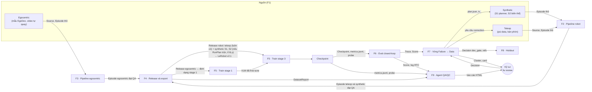
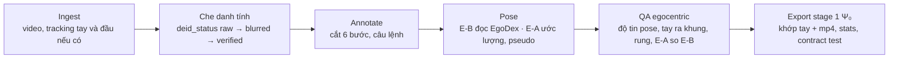
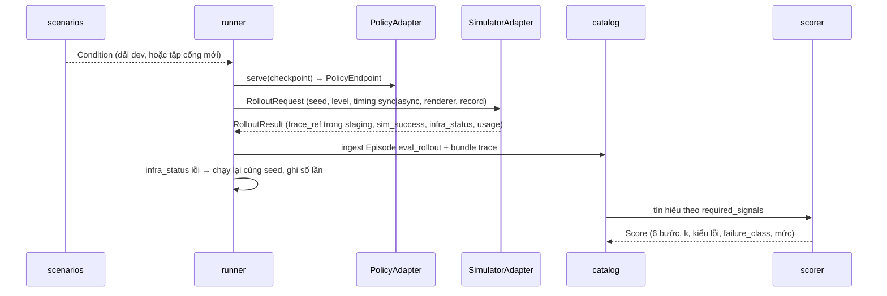
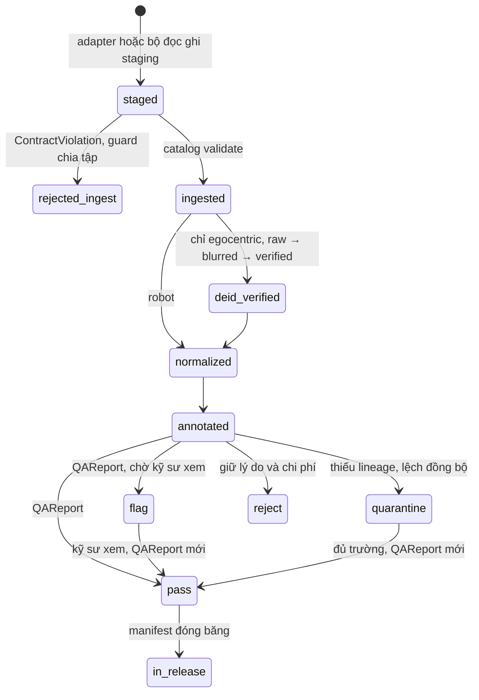

# 09 · Luồng dữ liệu: định nghĩa cho backend và website

_Ngày 30/10/2026. Trạng thái: **[Đề xuất]**, chờ Product Owner (Hiếu) duyệt. Tài liệu này không đặt quyết định mới về thuật toán hay kiến trúc. Nó gom các luồng dữ liệu đang rải ở [spec v10.4](../spec-v10-failure-to-data.md), [03 bản 0.7](03-architecture.md), [design 27/10/2026](../superpowers/specs/2026-10-27-g1-psi0-demo-design.md) và [design 28/10/2026](../superpowers/specs/2026-10-28-tray-transfer-he-design.md) (nháp) về một chỗ, theo dạng backend cần: ai ghi, ai đọc, nằm ở đâu, đổi trạng thái thế nào. Khi mâu thuẫn, spec, design và 03 thắng tài liệu này._

| Ngày | Phiên bản | Thay đổi | Tác giả |
|---|---|---|---|
| 30/10/2026 | 0.3 | Mục 7.2: trỏ tới [10](10-database.md), nơi schema đề xuất cách lấp G2, G4, G5, G6, G9 | PO (Hiếu), soạn cùng Claude |
| 30/10/2026 | 0.2 | Mục 2: sơ đồ tách train stage 1 và stage 3, ghi rõ teleop và synthetic vào stage 3; mục 4 F4: thành phần release và `MixSpec`; F5: bảng dữ liệu theo stage và công thức dữ liệu theo nhánh; F7 bước 11; mục 7.2 thêm G9 | PO (Hiếu), soạn cùng Claude |
| 30/10/2026 | 0.1 | Bản đầu | PO (Hiếu), soạn cùng Claude |

## 0. Đọc nhanh

1. **Nguồn sự thật là file** trong `$FW_ROOT/sites/local/` (03 mục 7.2): JSONL append-only cho metadata, Parquet cho trace và manifest, MP4 cho video. `index/fw.duckdb` chỉ chứa view. Backend không cần và không nên có DB riêng [Đề xuất].
2. **Chín luồng chính và hai luồng xuyên suốt** (mục 4): F1 nạp, F2 pipeline robot, F3 pipeline egocentric, F4 release và export, F5 train, F6 eval closed-loop, F7 vòng Failure → Data, F8 holdout, F9 Agent QA/QC và bộ lỗi cấy; X1 sổ chi phí, X2 quyết định và con trỏ.
3. **Mọi luồng nối nhau qua artifact có schema** trong `flywheel.contracts` (mục 3). Ba làn không gọi nhau trực tiếp; backend cũng nên chỉ thấy artifact, không thấy module bên trong.
4. **Hiện trạng 30/10/2026:** code mới có hợp đồng v0 ở biên adapter, 6 Protocol, bộ giả và `fw --version`. Mọi luồng dưới đây là thiết kế, chưa chạy. Schema 12 thực thể (S1-10) và artifact giữa làn (DA-25) chưa merge (mục 7.1).
5. **Một mâu thuẫn phải chốt trước khi dựng backend:** 03 mục 1.1 và 2.4, cùng CLAUDE.md, ghi "không có DB server hay API service ở L0" và "giao diện web đầy đủ" ngoài phạm vi L0. Backend và website là thay đổi phạm vi, cần quyết định và dòng change log ở 03 (mục 8, Q-B1).

## 1. Nguyên tắc backend phải giữ

Mỗi dòng là một bất biến đã có trong repo; cột cuối là hệ quả khi thiết kế API.

| Bất biến | Nguồn | Hệ quả cho backend |
|---|---|---|
| File là nguồn sự thật; DuckDB chỉ chứa view, mất thì tự tạo lại | 03 mục 1.2, 2.4, 7.2 | Backend đọc qua view DuckDB hoặc đọc file. Cache nào cũng phải xóa được mà không mất gì |
| Catalog, sổ chi phí, Decision, QAReport, FixRateEvent là append-only | 03 mục 4.3, 4.4; CLAUDE.md | API không có UPDATE hay DELETE. "Sửa" là ghi bản mới (bút toán đảo, QAReport mới, Decision mới). Trạng thái hiện hành là bản mới nhất theo đối tượng |
| Release đóng băng, RunPlan đóng băng, bundle episode bất biến | 03 mục 4.4, 8.1 | Đối tượng đã đóng băng chỉ đọc. Thêm dữ liệu là tạo release con |
| Adapter không ghi catalog; chỉ ghi `staging/` của job, `catalog` validate rồi mới ingest | 03 mục 5.3 điểm 2 | Upload từ website (vd video egocentric) cũng đi vào staging rồi qua ingest, không ghi thẳng vào `catalog/` |
| Holdout trong `vault/`, chỉ `gate` đọc | 03 mục 8.3; CLAUDE.md | Backend không bao giờ đọc `vault/`. Chỉ hiển thị Decision `holdout` và hash |
| `restricted`, `internal` không đi ra API hosted | CLAUDE.md; design 27/10 mục 8.4 | Nếu website chạy ngoài máy đội thì chỉ phục vụ dữ liệu `public`, lọc theo `data_class` ở tầng truy vấn |
| `injected_defect` không vào release train; `DefectManifest` chỉ bộ chấm đọc | CLAUDE.md; design 27/10 mục 9.2 | Không có endpoint trả `DefectManifest` trước khi agent chạy xong; bản sao cấy lỗi đánh dấu rõ trên giao diện |
| Video egocentric che danh tính trước mọi bước | CLAUDE.md; design 27/10 mục 6.6 | Không phục vụ video có `deid_status = raw` |
| Mọi job sinh `LedgerEntry`; ước tính và thực đo là hai trường | CLAUDE.md; 03 mục 1.2 | Job do backend khởi tạo cũng phải đi qua `ledger.meter`. Màn hình chi phí hiện hai cột, không gộp |
| Kỹ sư quyết, máy đề xuất | 03 mục 1.2 | Mọi nút "duyệt", "ghi đè", "ký cổng" trên website sinh một `Decision` có người, thời điểm, lý do |
| Job GPU chỉ Hiếu chạy, từ RunPlan | CLAUDE.md | Backend không tự phát job GPU; nút chạy job GPU cần phân quyền hoặc chỉ hiển thị lệnh |
| Lỗi hạ tầng không bao giờ là lỗi policy | 03 mục 5.3 điểm 8 | Hiển thị `infra_status` tách khỏi `sim_success`; thống kê thành công loại lượt có `infra_status != ok` |

## 2. Bản đồ tổng

Mũi tên liền là dữ liệu; nhãn là artifact. Ba loại dữ liệu cố định [Đã chốt, design 27/10 mục 5]: egocentric, teleop, synthetic. Nguồn test hiện giờ nằm trong ngoặc.



Không vẽ: mọi luồng đều ghi `LedgerEntry` (X1); mọi điểm quyết định ghi `Decision` (X2). Dữ liệu mỗi loại vào stage nào và trộn ra sao ở mục 4, F5.

## 3. Từ điển artifact

Đường dẫn tính từ `$FW_ROOT/sites/local/` (03 mục 7.2). Cột "Schema" cho biết model Pydantic đã có hay thuộc story nào.

| Artifact | ID | Lưu ở đâu, định dạng | Làn ghi | Làn đọc | Schema |
|---|---|---|---|---|---|
| Source | `src_<hash>` | `sources/<id>/` tệp gốc + `SOURCE.json`; dòng trong `catalog/source/` | Dữ liệu | Mọi làn | S1-10 |
| Episode | `ep_<ULID>` | Dòng trong `catalog/episode/`; bundle `episodes/<id>/`: `meta.json`, `frames.parquet` (`t_state`, `t_image`, cột `_cmd`, `_meas`), `signals.parquet`, `segments.parquet`, `videos/*.mp4` | Dữ liệu; adapter simulator cho trace | Đánh giá, Vòng, adapter Ψ₀ | S1-10, DA-01 |
| Condition | `cond_<hash>` | `catalog/condition/`; blob layout trong `objects/sha256/` | Đánh giá (`scenarios`) | Vòng, Dữ liệu (guard) | v0 tối thiểu; đủ ở S1-10 |
| QAReport | `qa_<ULID>` | `catalog/qa_report/` | Dữ liệu (`qa`) | Đánh giá, Vòng | DA-25 |
| ReplayReport | chưa định | chưa có đường dẫn trong 03 mục 7.2 | Dữ liệu (`replay_check`) | Agent QA/QC | DA-25 |
| DatasetReport | chưa định | chưa có đường dẫn; HTML tĩnh mỗi release (design 27/10 mục 6.5) | Dữ liệu | Agent QA/QC, website | DA-25 |
| Release | `rel_<hash>` | `releases/<id>/manifest.json`, `items.parquet`, `FROZEN`; dòng `catalog/release/` | Dữ liệu (`release`) | Vòng (`training`), adapter Ψ₀ | v0 tối thiểu; đủ ở S1-10 |
| Export (DatasetRef) | theo `mix_hash` | `exports/<release_id>/<format>-<mix_hash>/`, xóa và dựng lại được | Adapter trainer (`export_dataset`); egocentric: Dữ liệu (`export/egodex.py`) | Adapter Ψ₀ | v0 |
| RunPlan | `rp_<hash>` | `plans/<id>/runplan.yaml`, `runplan.lock.json`; dòng `catalog/run_plan/` | Vòng | Mọi làn, adapter | S1-10 (đóng băng ở story 2.1b) |
| Job | `job_<ULID>` | `runs/<run_plan_id>/<job_id>/`: `job.json`, `result.json`, `logs.jsonl`, `ledger.jsonl`, `metrics.jsonl`, `staging/` | Vòng (`runner`), adapter | Mọi làn | Chưa có model; `InfraStatus` có ở v0 |
| RolloutRequest, RolloutResult | theo `job_id` | `job.json`, `result.json` | Vòng → adapter simulator → Vòng | Đánh giá | v0 (thiếu `timing`, DA-25) |
| Trace | là Episode `eval_rollout` hoặc `diag_rollout` | như Episode | Adapter simulator | Đánh giá | như Episode |
| Checkpoint | `ckpt_<hash>` | `checkpoints/<id>/CHECKPOINT.json`, trọng số hoặc URI ngoài | Adapter Ψ₀, LeRobot (qua `training`) | Vòng, Đánh giá | v0 `CheckpointRef`; đủ ở S1-10 |
| metrics.jsonl | trong job | `runs/.../metrics.jsonl` | Adapter trainer | Đánh giá (DA-08), Agent QA/QC | DA-19, DA-25 |
| Kết quả probe P1–P4 | chưa định | chưa có đường dẫn | Adapter Ψ₀ (DA-09) | Đánh giá (DA-13), Agent QA/QC | DA-25 |
| Log inference RTC | chưa định | chưa có đường dẫn; `latency_profile_ref` trỏ tới | Vòng (`runner`, DA-23), adapter Ψ₀ | Đánh giá, Agent QA/QC | DA-25 |
| Score | `sc_<hash trace + scorer_version>` | `catalog/score/` | Đánh giá (`scorer`) | Vòng, Agent QA/QC | v0 `StageEvaluation` một phần; đủ ở S1-10 |
| Cluster | `clu_<hash>` | `catalog/cluster/`; `meta` chứa kết quả từng phép kiểm | Đánh giá (`diagnosis`) | Vòng (`decide`), Agent QA/QC | S1-10 |
| EvidenceCard | sinh lại từ Cluster và Decision | `rounds/<run_plan_id>/cards/<cluster_id>.html` | Đánh giá (`cards`) | Kỹ sư, website | Không lưu; là bản dựng |
| Kế hoạch vòng | `iv_<ULID>` mỗi can thiệp | `rounds/<run_plan_id>/plan.json` | Vòng (`decide`) | Vòng (`acquisition`) | S1-10 |
| Decision | `dec_<ULID>` | `catalog/decision/`; `kind`: plan_review, dev_gate, aa_test, holdout, milestone, repair_ticket | Vòng; kỹ sư qua `fw review` | Mọi làn | S1-10 |
| LedgerEntry | `led_<ULID>` | `runs/**/ledger.jsonl` | Mọi làn qua `store` | Vòng (`ledger`, `reports`) | S1-10 |
| FixRateEvent | `fre_<ULID>` | `catalog/fix_rate_event/` | Vòng (`gate`) | Vòng (`decide`) | S1-10 |
| Con trỏ | tên nhánh | `refs/policy/<nhánh>/current`, `refs.log` | Vòng (`gate`) | Mọi làn | Chưa có |
| Holdout | sha256 | `vault/holdout/` | Chỉ `gate` | Chỉ `gate` | Chưa có |
| DefectManifest | hash khóa trước | chưa có đường dẫn | Dữ liệu (`inject`, DA-27) | Chỉ bộ chấm (DA-31), sau khi agent chạy | DA-25 |
| Báo cáo Agent QA/QC | theo job | HTML tĩnh mỗi job; chưa có đường dẫn | Đánh giá (`agentqa`, DA-20) | Kỹ sư, website | Chưa có |
| Phiên HD | | `hd/assignments.json`, `hd/sessions.jsonl` | Vòng (`reports`, HD) | Vòng | Chưa có |

Cấu hình có hash, không phải bảng catalog (03 mục 4.1): Embodiment (gồm `action_layout` 36 chiều, `control_spec`, `camera_ref_hash`), Task (`ConditionSchema`, `StageSpec`, `FailureKindSpec`), SplitPlan, PriceBook, ngưỡng QA và chẩn đoán, recipe train, prompt Agent QA/QC. Nằm trong `configs/`, ghim trong RunPlan. Backend đọc được nhưng không sửa; đổi cấu hình là PR.

## 4. Các luồng

Mỗi luồng ghi: kích hoạt, đầu vào, các bước, đầu ra, story và người làm (07 mục 2.0, 2.2). Lệnh `fw` lấy từ tài liệu; trừ `fw --version`, chưa lệnh nào có trong code.

### F1 · Nạp dữ liệu (Ingest)

Mỗi nguồn có bộ đọc riêng, cùng đầu ra: `Source` (nếu là tệp ngoài) và `Episode` thô kèm bundle trong staging, rồi `catalog` validate và ghi.

| Nguồn | Loại | Kích hoạt | Trường đặc trưng của Episode | Story |
|---|---|---|---|---|
| psi-data task hai bàn (LeRobot v2.1 của fork Ψ₀) | teleop | `fw import psi-data --task … --revision …` | `source_detail = psi_data`, `action_quality = measured`, `embodiment_id = g1_sonic_dwbc@1`, `operator_kind = human`, `kind = teleop_demo` | S1-07, DA-03 (Thông) |
| Teleop bàn phím trong SIMPLE | teleop | Phiên teleop `--record`; mỗi phiên một `LedgerEntry` (phút người, số episode, số đạt) | `source_detail = teleop_keyboard`, `measured`; nhãn thành công của người chỉ để đối chiếu | DA-16 (Hiếu) → DA-03 |
| S1 planner | synthetic | `GeneratorAdapter.generate` từ F7 hoặc lệnh sinh hàng loạt | `synthetic_tier = S1`, `action_quality = planned`, `source_detail = planner_wbc` hoặc `planner_amo` (embodiment AMO riêng), tuyến, phiên bản planner; ghi cả lượt hỏng | S1-05, S1-11 (Hiếu) → DA-03 |
| S2 biến thể | synthetic | `GeneratorAdapter.generate` | `synthetic_tier = S2`, `planned`, `parent_id` trỏ episode teleop gốc, tham số biến đổi | DA-29 (Hiếu) → DA-03 |
| Mẫu EgoDex | egocentric | Lệnh ingest egocentric | `source_kind = egocentric`, `embodiment_id = human_ego@1`, `action_quality = retargeted`, `deid_status = raw` | DA-04 (Hưng) |
| Video đội tự quay | egocentric | Upload video kèm thông tin thiết bị | như trên, `action_quality = pseudo` | DA-04 (Hưng) |
| Trace eval | (trace) | Do F6 sinh, không qua F2 | `kind = eval_rollout` hoặc `diag_rollout`, `checkpoint_id`, `rollout_seed`, `sim_success`, `infra_status` | S1-08, DA-23 |

Ràng buộc chung khi ingest: sha256 cho mọi tệp; `license` và `data_class` bắt buộc; thiếu trường bắt buộc là `ContractViolation`, không ingest một phần (03 mục 5.3). Guard chia tập chạy ngay khi ingest: episode không phải trace mà có seed thuộc dải dev hoặc holdout, hoặc `layout_hash` trùng, bị từ chối (03 mục 8.3 điểm 3).

### F2 · Pipeline robot (teleop và synthetic)

Tầng 2–4 của pipeline 6 tầng (design 27/10 mục 6). Người làm: Thông (DA-03, DA-17), Châu (scorer cho phép kiểm "kết quả task").

| Tầng | Việc | Ghi ra |
|---|---|---|
| 2 · Normalize | Đồng bộ về đồng hồ chung, nội suy state về tần số điều khiển, giữ `t_image` riêng từng camera; SI, radian, khung URDF G1; ánh xạ vào `action_layout` đệm 36 chiều kèm mask; ảnh 180 × 320, giữ bản gốc; chuẩn hóa câu lệnh; nguồn AMO qua bộ ánh xạ riêng khi V3 cho phép | Bundle chuẩn (`frames.parquet` cột `_cmd`, `_meas`) |
| 3 · Annotate | Cắt đoạn theo 6 bước task (luật trước, model gợi ý, người duyệt mẫu); nhãn ngôn ngữ | `segments.parquet` (`t_start`, `t_end`, `step_id`, mô tả, nguồn nhãn `rule`, `human`, `model`) |
| 4 · QA | 8 phép kiểm của spec mục 4.4 (timestamp, đồng bộ ảnh và state, giới hạn khớp và giá trị hữu hạn, bước nhảy action, kết quả task theo scorer, lineage, phát lại action, chia tập); phép kiểm riêng nguồn (design 27/10 mục 6.3) | `QAReport` (pass, flag, quarantine, reject + giá trị và ngưỡng), `ReplayReport` (động học: loại khi trượt; động lực học: đánh dấu) |

Phát lại action gọi `SimulatorAdapter.replay()` của SIMPLE, nên tầng 4 là chỗ duy nhất trong làn Dữ liệu cần simulator; làn code trên bản giả, chạy thật qua job (DA-17). Episode hỏng theo scorer không làm mẫu dương nhưng giữ làm bằng chứng lỗi. Mẫu bị loại giữ lý do và chi phí.

Ở G1, `qa` chạy thêm chế độ hiệu chỉnh trên demo teleop thành công, ghi `configs/thresholds/<version>.yaml` có hash (03 mục 6.1). Release đầu tiên tham chiếu phiên bản ngưỡng đó.

### F3 · Pipeline egocentric

Người làm: Hưng (DA-04, DA-18); stage 1 chạy thật là Hiếu (DA-30).



- `catalog` chặn rời bước Annotate khi `deid_status = raw` (03 mục 4.3).
- Episode egocentric không có action robot: chỉ vào stage 1, probe P1, P2 và làm mẫu cho bộ sinh; **không bao giờ vào stage 3** (design 27/10 mục 6.6).
- Episode đạt QA đi vào `release` của Thông qua API công khai của làn (07 mục 2.0); release egocentric export bằng `export/egodex.py`, không phải LeRobot.

### F4 · Release và export

Người làm: Thông (DA-02, DA-21, tầng 5–6); Long giữ schema.

1. `fw release create` dựng manifest nháp (`items.parquet`: `episode_id`, trọng số mẫu, cờ `excluded` kèm lý do). Một release robot chứa cả teleop và synthetic khi thí nghiệm cần trộn; `meta` của release đếm số episode theo `source_kind`, `source_detail`, `synthetic_tier` và theo `is_root` (03 mục 4.3), nên luôn biết release có bao nhiêu demo người và bao nhiêu mẫu sinh. Release egocentric tách riêng vì đi stage khác.
2. Guard trước khi đóng băng: mọi item có QAReport pass, hoặc flag đã có kỹ sư xem; seed, `layout_hash` và gần trùng (d_dup) theo SplitPlan; không trộn `embodiment_id` khác nhau nếu chưa có Decision V3 (ADR-08); `pseudo`, `retargeted` chỉ khi RunPlan cho phép; không có episode mang `injected_defect`; giấy phép gộp.
3. `fw release freeze`: hash manifest, thư mục chỉ đọc, ghi `FROZEN`. Thêm dữ liệu là release con với `parent_release_id`.
4. Export (`TrainerAdapter.export_dataset(release, mix, out_uri)`). `mix` là `MixSpec`: trọng số lấy mẫu theo nhóm nguồn, vd teleop và synthetic với tỉ lệ mẫu sim trong batch ρ ∈ {0,25; 0,5} (spec mục 7.3 điểm 4); hash của `mix` nằm trong tên thư mục export. Đích: LeRobot v2.1 đúng fork `songlin/lerobot@09929d8`, `stats_psi0.json` tính trên đúng release, checklist 7 điểm (design 27/10 mục 6.4), đọc lại bằng loader Ψ₀; v3 tùy chọn; egocentric ra định dạng stage 1. Kết quả là `DatasetRef`; thư mục export xóa và dựng lại được.
5. Dựng `DatasetReport` HTML: số episode theo nguồn, pass, flag, reject theo phép kiểm, phân bố điều kiện, độ dài, stats theo nhóm action, video phát lại cạnh video gốc. Đây là phần "hiệu suất pipeline" của demo 17/11.

### F5 · Train

Người làm: Hiếu (DA-19, DA-30, DA-09); Châu đọc log (DA-08). Chạy trên Colab Pro hoặc máy 3060, chỉ từ RunPlan đã đóng băng.

**Dữ liệu vào train theo stage** (spec mục 2.5; design 27/10 mục 5, 6.6):

| Loại dữ liệu | Stage 1 · VLM | Stage 2 · action expert | Stage 3 · fine-tune task | Điều kiện |
|---|---|---|---|---|
| Teleop (psi-data, bàn phím; `measured`) | Không | Không train stage 2 | **Luôn có**: là demo người, phần lõi của mọi release robot | Đạt QA; cùng `embodiment_id` `g1_sonic_dwbc@1` |
| Synthetic S1, S2 (`planned`) | Không | Không train stage 2 | **Khi RunPlan trộn**: nhánh B, C, B-fail, B⁺; vòng Failure → Data; task bê khay (S1 là demo robot chính) | Đạt QA và rollout lại đạt; trộn theo ρ trong `MixSpec`; S1 tuyến B (AMO) chỉ trộn khi có Decision V3 (ADR-08) |
| Egocentric (`retargeted`, `pseudo`) | Có: chạy ngắn trên EgoDex, fine-tune trên video tự quay | Không train stage 2 | **Không bao giờ** | Đã che danh tính; RunPlan cho phép `pseudo`, `retargeted` |

**Công thức dữ liệu stage 3 theo thí nghiệm.** Các nhánh chỉ khác nhau ở release; recipe (số bước, batch, learning rate, tăng cường thị giác) giống nhau (spec mục 7.3).

| Thí nghiệm, nhánh | Teleop | Synthetic | Nguồn |
|---|---|---|---|
| A | D\* demo | Không | spec mục 7.2 |
| A₀.₇ | 0,7D\* demo (một danh sách dùng chung cho mọi nhánh dưới) | Không | spec mục 7.2 |
| B | 0,7D\* | N_B rollout sim đạt QA, lấy đều trong miền train | spec mục 7.2 |
| C | 0,7D\* (+ correction teleop nếu vòng chọn) | Dữ liệu do vòng Failure → Data chọn (S1, S2, phục hồi), chặn ở B_add | spec mục 7.2; F7 |
| B-fail | 0,7D\* | Sim quanh mọi điều kiện lỗi dev, cùng B_add | spec mục 7.2 |
| HE task hai bàn | N ∈ {10, 20, 40, 80} demo psi-data (HE-1); bàn phím ở HE-2 | Không ở HE-1; có ở HE-2 (dữ liệu sinh tự động) | design 27/10 mục 7.3, 7.4 |
| HE-T bê khay (nháp) | Bàn phím khi có, làm phần phụ | S1 khay là demo robot chính: N_full = 80, N_cut = 40 | design 28/10 mục 5, 6.2 |

Vì vậy đầu vào của F5 không phải "một DatasetRef" chung chung mà là: release robot (teleop ± synthetic) cộng `MixSpec` cho stage 3, và release egocentric cho stage 1. Cả hai ghim bằng hash trong RunPlan.

| Bước | Đầu vào | Đầu ra |
|---|---|---|
| Dựng `TrainSpec` | RunPlan (recipe chung, seed, `release_id`, `MixSpec`), `DatasetRef` của bản export tương ứng, checkpoint cha | `job.json` |
| `TrainerAdapter.estimate` | `TrainSpec` | `LedgerEntry` ước tính |
| `TrainerAdapter.train` | `TrainSpec`; tiếp tục được theo `job_id` (`resume_from_checkpoint=latest`) | `metrics.jsonl` (gồm loss theo nhóm action, theo vị trí trong chunk, phương sai dự đoán do lớp bọc tính lại), checkpoint trung gian, `LedgerEntry` thực đo (compute unit Colab) |
| Đăng ký | `TrainResult` | `Checkpoint` (`method`, `branch`, `release_id`, `parent_checkpoint_id`, hash trọng số) |
| Probe | Checkpoint, bộ probe có hash | Kết quả P1–P4 |
| Phát hiện lỗi train và offline | `metrics.jsonl`, P3 | Cờ T1–T8, O1–O4 trên checkpoint; chỉ T1 (phân kỳ) dừng job |

Stage 1 (VLM) chỉ chạy ngắn trên EgoDex do F3 xuất để chứng minh đường đi, và fine-tune thật khi có video đội tự quay. Stage 2 không train. Stage 3 là mọi điểm của HE, E1 và các nhánh.

### F6 · Eval closed-loop

Người làm: Long (`runner`, DA-23), Châu (`scenarios`, `scorer`), Hiếu (`SimpleSim`, `Psi0Policy`).



- `rollout_seed = H(condition_id, replicate)`, không phụ thuộc nhánh, để mọi nhánh thấy cùng môi trường (03 mục 8.2).
- Chỉ số chính là `sim_success` (cờ `check_success` của SIMPLE, ADR-14); scorer cho chỉ số theo bước.
- Chế độ: đồng bộ cho G0 và HE (so được với tác giả); bất đồng bộ (chèn độ trễ từ log inference) cho HS, HT sau demo (design 27/10 mục 8.5).
- Renderer (`mujoco` hoặc `isaac`) ghi ở mọi con số; ảnh train và ảnh eval cùng renderer trong một thí nghiệm (design 27/10 mục 4.2).

### F7 · Vòng Failure → Data

Theo 03 mục 2.3 và 6.2; RunPlan `purpose = round`. Người làm: Châu (`diagnosis`, `cards`, DA-13), Long (`decide`, `acquisition`, `gate`, `ledger`), Hiếu (generator, teleop).

| # | Bước | Module | Đầu ra |
|---|---|---|---|
| 1 | Rollout policy cha trên 90 điều kiện dev chưa dùng | F6 | Trace, Score |
| 2 | Gom cụm theo (k, kiểu lỗi, mức) | `diagnosis` | Cluster nháp |
| 3 | Phép kiểm thuần dữ liệu 1–6: thiếu tín hiệu, đồng bộ, camera chuẩn, bám lệnh WBC, độ trễ, ngoài miền | `diagnosis` | `meta` của Cluster: giá trị, ngưỡng, `skipped` kèm lý do |
| 4 | Bước 4b: gắn giả thuyết stage từ probe P1, P3, P4 (chỉ hiện trên card) | `diagnosis` | `meta` của Cluster |
| 5 | Phép kiểm tốn rollout 7–9 trên tối đa R đại diện: khả thi (`plan`), khoanh vùng (`plan(until_stage=k)` rồi M lượt), thị giác (`VisualOverride`) | `diagnosis` → `GeneratorAdapter`, F6 | Episode `diag_rollout`; chẩn đoán |
| 6 | Phép kiểm 10: vùng phủ (kNN tới train so τ_cov) | `diagnosis` | Chẩn đoán THIẾU VÙNG PHỦ hoặc KỸ NĂNG YẾU |
| 7 | Cụm hệ thống và KHÔNG KHẢ THI thành phiếu sửa | `decide` | Decision `repair_ticket` (không tiêu ngân sách dữ liệu) |
| 8 | Lập kế hoạch: g theo n_eff, c theo bảng giá, tham lam g/c trong ngân sách | `decide` ← `ledger` (FixRate, PriceBook) | `plan.json` nháp, mỗi can thiệp `iv_<ULID>` |
| 9 | Kỹ sư duyệt hoặc ghi đè kèm lý do, đọc card và báo cáo Agent QA/QC | `fw review` | Decision `plan_review` |
| 10 | Thực thi: sinh S1, S2 quanh điều kiện lỗi; teleop correction; dữ liệu phục hồi từ trạng thái lỗi; chặn ở ngân sách | `acquisition` → F1, F2 | Episode mới có `intervention_id`, `LedgerEntry` thực đo |
| 11 | Release con, đóng băng: release cha (0,7D\* teleop) cộng episode mới của vòng (synthetic, correction, phục hồi) | F4 | Release |
| 12 | Fine-tune từ cha với recipe chung | F5 | Checkpoint ứng viên |
| 13 | Cổng dev: tập cổng 90 điều kiện mới, cha và ứng viên ≥ 3 lượt, sàn A/A | `gate` → F6 | Decision `dev_gate`; đạt thì đổi `refs/policy/<nhánh>/current` |
| 14 | Tỉ lệ sửa được có đối chứng quanh điểm lỗi của từng cụm đã can thiệp | `gate` → F6 | `FixRateEvent`; `ledger` cập nhật posterior Beta |
| 15 | Báo cáo vòng, card, sổ chi phí, điều kiện dừng | `reports` | HTML, Markdown |

Biến thể: nhánh B-fail chạy cùng luồng với `diagnosis: off` (sinh sim quanh mọi lỗi dev). `diagnosis` và `decide` từ chối trace có `split = holdout`. Đóng một phiếu sửa thì `gate` đánh dấu mọi số đo của policy hiện tại là cũ và yêu cầu chạy lại baseline.

### F8 · Holdout

Chỉ `gate` chạy, qua `fw holdout run --plan rp_holdout` (03 mục 6.3, 8.3). Đọc `vault/holdout/conditions.parquet`, so sha256, ghi khóa `locks/<checkpoint_id>.json` (mỗi checkpoint một lần), chạy F6, niêm phong kết quả của nhánh chạy sớm trong `sealed/`, bootstrap phân cấp khi đủ checkpoint, ghi Decision `holdout`. Trước đó `fw holdout precheck` chạy power analysis trên dev, ghi Decision `milestone` G2.

Đối với backend: luồng này chỉ hiện ra ngoài dưới dạng Decision và hash. Không có endpoint nào trả điều kiện holdout hay kết quả đang niêm phong.

### F9 · Agent QA/QC và bộ lỗi cấy

Người làm: Hưng (DA-20, DA-31), Thông (DA-27).

```text
job dữ liệu / train / eval / infer ─► code tính số và dựng hình ─► Agent QA/QC viết báo cáo ─► kỹ sư duyệt (fw review)
```

| Phần | Đầu vào | Đầu ra |
|---|---|---|
| Agent QA/QC | `DatasetReport`, `ReplayReport`, `metrics.jsonl`, kết quả probe, log RTC, `Score`, `Cluster`; prompt có hash trong `configs/eval/agentqa/`; Nemotron cục bộ (`llm-serve`) | Báo cáo HTML mỗi job: phát hiện, bằng chứng (đường dẫn hình và số), insight, ước lượng có khoảng, đề xuất |
| Cấy lỗi (DA-27) | Bản sao dữ liệu thật, log train và log RTC (giả từ testkit cho tới khi có log thật) | Bản sao có `injected_defect` (D1–D8, T1–T8, R1–R2), `DefectManifest` khóa bằng hash trước khi agent chạy |
| Bộ chấm (DA-31) | Báo cáo của agent, kết quả QA tầng 4, `DefectManifest` (chỉ đọc sau khi agent chạy) | Precision, recall theo loại lỗi; tỉ lệ báo nhầm trên bản sạch; tách phần code bắt và phần agent thêm |

Agent không đọc `vault/`, không chạy job, không chọn dữ liệu, không đưa số không có trong đầu vào. Mọi con số do code tính.

### X1 · Sổ chi phí

Mọi job gọi `ledger.meter(...)`, ghi `runs/<run_plan_id>/<job_id>/ledger.jsonl`. Mỗi dòng: hoạt động, loại tài nguyên (giờ người, GPU-giờ, compute unit Colab, lưu trữ), số lượng, đơn vị, `pricebook_id`, thành tiền, cờ `estimated` hoặc `measured`, nhánh, `run_plan_id`, cụm, `intervention_id`, người (mã giả danh). Sửa sai bằng bút toán đảo. Đọc: `decide` (đơn giá, ngân sách vòng), `reports` (sổ chi phí, sai số dự báo chi phí).

### X2 · Quyết định và con trỏ

`Decision` là cách duy nhất để một người làm đổi hướng hệ thống: duyệt kế hoạch, ghi đè chẩn đoán, ký cổng, chọn tuyến V3, rút gọn thí nghiệm. Con trỏ đổi được chỉ nằm trong `refs/`, mỗi lần đổi ghi một dòng `refs.log` kèm lý do và ID Decision.

### Thí nghiệm là tổ hợp của các luồng

| Thí nghiệm | Nguồn | Luồng dùng | Ghi chú |
|---|---|---|---|
| G0 tái tạo Ψ₀ | 03; S1-03 | F6 với checkpoint `simple-checkpoints` | RunPlan `g0_repro`, duy nhất được trỏ tới checkpoint đó |
| HE task hai bàn | design 27/10 mục 7; DA-26 | F1–F2–F4 (psi-data) → F5 (ba checkpoint ablation × N ∈ {10, 20, 40, 80}) → F6 | Danh sách demo lồng nhau cố định bằng hash trong RunPlan |
| Stage 1 egocentric | design 27/10 mục 7.8; DA-30 | F3 → F4 → F5 stage 1 → F5 stage 3 → F6 | Lần chạy ngắn chỉ chứng minh đường đi |
| HE-T task bê khay (nháp) | design 28/10 mục 6; DA-32–34 | F1 (S1 khay) → F2 → F4 → F5 (A, C, C-NOEGO; B khi có video) → F6 | Task 7 bước, kiểu lỗi mới; chưa duyệt |
| Vòng C, B-fail, F-ACT | spec mục 7; 03 mục 6.2 | F7 | Sau demo, trừ một vòng trên eval HE cho demo 17/11 |
| HD | spec mục 7.6; 03 mục 6.4 | F6 với `FaultSpec`, F7 bước 2–6, console `fw hd` | Sau demo |

## 5. Vòng đời trạng thái

Mọi trạng thái là **bản ghi mới nhất theo đối tượng**, không cập nhật tại chỗ (03 mục 4.4 điểm 5).

**Episode** (robot và egocentric):



**Các đối tượng khác:**

| Đối tượng | Trạng thái | Chuyển bởi |
|---|---|---|
| Release | draft → frozen; frozen sinh release con | `fw release create`, `fw release freeze` |
| RunPlan | draft → frozen (`runplan.lock.json`) | `fw plan freeze` (từ chối cây git bẩn, image không ghim digest, checkpoint gốc chưa sạch) |
| Job | **chưa định nghĩa** (mục 7.2); chỉ có `infra_status`: ok, simulator_error, policy_error, timeout, out_of_memory | `runner` |
| Checkpoint | registered → probed → (dev_gate đạt) con trỏ `current` → holdout locked | `training`, adapter Ψ₀, `gate` |
| Can thiệp `iv_` | đề xuất → duyệt hoặc ghi đè (Decision `plan_review`) → đang thu → xong; số lượng đếm từ Episode theo `intervention_id`, chi phí cộng từ LedgerEntry | `decide`, `fw review`, `acquisition` |
| Phiếu sửa | mở → đóng → `rebaseline_required` | Decision `repair_ticket` mới |
| Score | bất biến theo `scorer_version`; chấm lại là bản mới song song | `scorer` |

## 6. Gợi ý cho backend [Đề xuất]

### 6.1 Hình thái

Backend là một tiến trình đọc `$FW_ROOT` và một hàng đợi lệnh, không phải nguồn sự thật thứ hai:

| Phía | Cách làm | Lý do |
|---|---|---|
| Đọc | Mở `index/fw.duckdb` (view trên `catalog/**`, `runs/**/ledger.jsonl`, Parquet) và đọc trực tiếp bundle, video, HTML đã dựng | Đúng 03 mục 7.2; không phải đồng bộ hai nơi |
| Ghi | Mỗi hành động là một lệnh `fw …` chạy thành job (có `job_id`, `logs.jsonl`, `ledger.jsonl`); backend chỉ theo dõi thư mục job | Giữ mọi guard, validate và sổ chi phí ở một chỗ; website không mở được đường tắt quanh `catalog` |
| Theo dõi | Đọc nối `logs.jsonl` của job (SSE hoặc WebSocket) | Log đã là JSON lines có `run_plan_id`, `job_id`, `episode_id` (03 mục 3.1) |

Quyết định cần chốt ở Q-B2: backend gọi lệnh `fw` (tách tiến trình) hay import API công khai của làn như một composition root thứ hai cạnh `flywheel.cli`. Luật import cho phép điều sau chỉ với `flywheel.cli` (03 mục 7.3).

### 6.2 Nhóm tài nguyên

| Tài nguyên | Đọc từ | Hành động (→ lệnh) | Luồng |
|---|---|---|---|
| Sources | view `source`, `sources/` | Nạp psi-data (`fw import psi-data`) | F1 |
| Episodes | view `episode`, `qa_report`; bundle; `segments.parquet`; video | Upload egocentric vào staging (lệnh ingest egocentric) | F1–F3 |
| Releases, exports | view `release`; `releases/`, `exports/`; `DatasetReport` | Tạo, đóng băng (`fw release create`, `fw release freeze`); export | F4 |
| RunPlans | `plans/`; view `run_plan` | Đóng băng (`fw plan freeze`) | mọi luồng |
| Jobs | `runs/<rp>/<job>/` | Hủy, chạy lại lượt lỗi hạ tầng | mọi luồng |
| Checkpoints | view `checkpoint`; `metrics.jsonl`; probe | Không (job GPU do Hiếu chạy) | F5 |
| Evals, scores | view `episode` (kind trace), `score` | Chạy eval dev (`runner`) | F6 |
| Rounds | view `cluster`, `decision`; `rounds/<rp>/plan.json`, `cards/` | Bắt đầu vòng (`fw round start`), duyệt hoặc ghi đè (`fw review`) | F7 |
| Decisions | view `decision` | Ghi Decision mới | X2 |
| Ledger | view ledger | Ghi tay giờ người (`fw ledger add`) | X1 |
| Agent QA/QC | báo cáo HTML, bảng precision và recall | Đồng ý hoặc ghi đè (Q-B5) | F9 |
| Holdout | chỉ Decision `holdout` và hash | Không | F8 |

### 6.3 Thứ tự dựng

1. Đọc trên file mẫu của `flywheel.testkit` (DA-25, hạn 30/10/2026) và một `$FW_ROOT` giả dựng bằng bộ giả; chưa cần SIMPLE hay GPU.
2. Thêm màn hình theo mốc dữ liệu thật của 07 mục 2.0: gói psi-data có hash (30/10), trace SIMPLE và `metrics.jsonl` đầu tiên (6/11), log eval HE (12/11).
3. Hành động ghi chỉ thêm khi lệnh `fw` tương ứng đã có trong code.

## 7. Hiện trạng và khoảng trống

### 7.1 Code đã có (master `bf773b4`)

| Phần | Có | Chưa |
|---|---|---|
| `flywheel.contracts` | 6 Protocol ([protocols.py](../../packages/flywheel-contracts/src/flywheel/contracts/protocols.py)); model v0 ở biên adapter ([v0.py](../../packages/flywheel-contracts/src/flywheel/contracts/v0.py)): `RolloutRequest`, `RolloutResult`, `TrainSpec`, `GenerationRequest`, `TeleopRequest`, `PlanRequest`, `Condition`, `ReleaseManifest`, `StageEvaluation` | 12 thực thể catalog (S1-10), artifact giữa làn (DA-25), trường Episode mới và `action_layout` (DA-01) |
| `flywheel.testkit` | Bộ giả sim, policy, trainer, generator, teleop, task; contract suite | File mẫu mọi artifact, bộ lỗi cấy mẫu |
| `flywheel.store` | Thư mục rỗng | Kho sha256, view DuckDB, refs, sổ chi phí, khóa vault |
| `flywheel.cli` | `fw --version`, đăng ký lệnh con qua entry point | Mọi lệnh khác |
| Ba làn | Khung thư mục, `api.py`, `cli.py`, `config.py` rỗng | Toàn bộ logic |
| Adapter `flywheel-simple`, `flywheel-psi0` | `__init__.py` | Toàn bộ |
| `fwdata/` | Repo SIMPLE và Ψ₀, log smoke | Bố cục `sites/local/` của 03 mục 7.2 chưa tồn tại; backend chỉ quét `sites/` |

### 7.2 Khoảng trống trong tài liệu

Backend cần các điểm này có câu trả lời; mỗi dòng cần chủ quyết. (bản 0.3) Schema ở [10](10-database.md) đã đề xuất cách lấp G2 (vòng đời `job`), G4 (bốn loại Decision mới), G5 (bảng `train_flag`), G6 (ba `purpose` mới) và G9 (`dataset_export` nối release với `MixSpec`); các đề xuất này vẫn cần PR hợp đồng (10 mục 8).

| # | Khoảng trống | Ở đâu | Đề xuất người chốt |
|---|---|---|---|
| G1 | 03 cấm API service và giao diện web ở L0, trong khi đội cần backend và website | 03 mục 1.1, 2.4; CLAUDE.md "Không làm" | Hiếu (Q-B1) |
| G2 | Vòng đời Job chưa định nghĩa: chỉ có `infra_status`, không có queued, running, succeeded, cancelled | 03 mục 4.3 "Job là thư mục" | Long (S1-10) |
| G3 | Đường dẫn lưu chưa có cho `DatasetReport`, `ReplayReport`, kết quả probe, log RTC, `DefectManifest`, báo cáo Agent QA/QC | 03 mục 7.2 | Long (DA-25), Hiếu sửa 03 |
| G4 | Đồng ý hoặc ghi đè của kỹ sư trên báo cáo Agent QA/QC lưu ở đâu; `Decision.kind` chưa có loại cho việc này | design 27/10 mục 9.1; 03 mục 4.3 | Hiếu (Q-B5) |
| G5 | Cờ T1–T8, O1–O4 trên checkpoint lưu ở đâu (`Checkpoint.meta` bất biến, nên cần bản ghi riêng) | design 27/10 mục 10; DA-08 | Châu, Long |
| G6 | `RunPlan.purpose` chưa có giá trị cho HE, stage 1, HE-T | 03 mục 4.3, 8.1; DA-26, DA-30, DA-34 | Hiếu |
| G7 | 03 mục 5.2 còn câu về robot DENSO cho `sim_success` (ADR-21 đã bị thay) | 03 mục 5.2 | Hiếu, sửa kèm change log |
| G9 | `TrainSpec` v0 chỉ có `dataset: DatasetRef`, chưa có `release_id` và `MixSpec`; checkpoint chỉ truy ngược được công thức trộn teleop và synthetic qua hash trong đường dẫn export | [v0.py](../../packages/flywheel-contracts/src/flywheel/contracts/v0.py); 03 mục 4.3 (`Checkpoint.release_id`) | Long (S1-10) |
| G8 | Task bê khay thêm task 7 bước và kiểu lỗi mới; scorer và `TaskDefinition` của nó chưa có chỗ trong cây cấu hình của Châu | design 28/10 mục 3.3, 8 (nháp) | Hiếu khi duyệt design 28/10 |

## 8. Câu hỏi cho Product Owner

| Mã | Câu hỏi | Ảnh hưởng |
|---|---|---|
| Q-B1 | Backend và website có được thêm ở L0 không, hay ghi là L1 và chỉ dựng sau demo 17/11? | Sửa 03 mục 1.1, 2.4 và CLAUDE.md; story mới; chủ đường dẫn |
| Q-B2 | Backend ghi bằng cách gọi lệnh `fw` hay import API của làn như composition root thứ hai? | Luật import-linter; nơi đặt guard; độ trễ hành động |
| Q-B3 | Một người dùng hay nhiều người, có đăng nhập không? Ai được bấm hành động nào (vd chỉ Hiếu chạy job GPU)? | `Decision` cần người ký thật; phân quyền |
| Q-B4 | Website chạy cục bộ trên máy đội hay public? | Lọc theo `data_class`; video egocentric; khóa API |
| Q-B5 | Kết quả duyệt báo cáo Agent QA/QC lưu thành `Decision` loại mới hay trong `meta` của Decision `plan_review`? | Schema DA-25, S1-10 |
| Q-B6 | Website hiện cả task bê khay (design 28/10 còn nháp) hay chỉ task hai bàn? | Phạm vi màn hình thí nghiệm |
